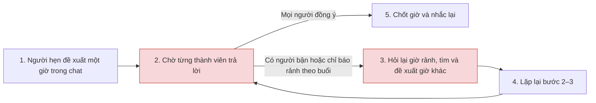
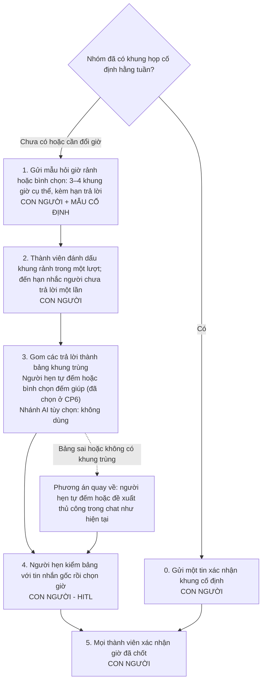

# Báo cáo nhóm — Day 02 Discovery & Problem Framing

> Bản chung của nhóm, viết trên repo do nhóm trưởng fork. Không copy file này sang repo cá nhân.
> Template chi tiết và prompt mẫu: [docs/01-worksheet.md](../../docs/01-worksheet.md). Bài mẫu: [docs/02-deliverable-example.md](../../docs/02-deliverable-example.md).

## 1. Thông tin nhóm

- Tên nhóm: UIT
- Trưởng nhóm: Hà Lê Duy
- Thành viên và phân công: [TEAM.md](../../TEAM.md)
- Candidate problem được chọn (1 câu): **L3 — Chốt giờ họp nhóm.** Thành viên nhóm 3–4 người phải chờ phản hồi và đề xuất lại nhiều vòng để tìm giờ mọi người đều rảnh.
- Quyết định cuối: Go / Not Yet / No-Go

---

## 2. Hội tụ nhóm (CP3)

### 2.1. Pitch

Danh sách chuẩn bị pitch lấy từ CP2 của [Hà Lê Duy](../individual/2A202603851_HaLeDuy.md#3-top-3-problem-cards--quy-trình-nháp-cp2), [Võ Hồng Lương](../individual/2A202603839_VoHongLuong.md#3-top-3-problem-cards--quy-trình-nháp-cp2), [Nguyễn Đức Nhật](../individual/2A202603812_NguyenDucNhat.md#3-top-3-problem-cards--quy-trình-nháp-cp2) và [Nguyễn Thiên Bảo](../individual/2A202603861_NguyenThienBao.md#3-top-3-problem-cards--quy-trình-nháp-cp2). Số trong mã tương ứng với số Problem Card. Các mốc thời gian đến từ báo cáo cá nhân và cần được xác nhận trước khi dùng làm baseline.

Mỗi người phụ trách phản biện một card của mỗi thành viên còn lại. Câu hỏi chuẩn bị lấy từ CP2 hoặc [worksheet CP3](../../docs/01-worksheet.md#bước-1--pitch-12). Trong buổi pitch, người nghe tự đặt câu hỏi theo nội dung trình bày, rồi ghi câu đã hỏi, người hỏi và điểm cần kiểm chứng.

| Mã | Người pitch | Candidate (Job Story ngắn) | Actor | Bottleneck theo CP2 | Người phụ trách phản biện | Câu hỏi chuẩn bị |
|---|---|---|---|---|---|---|
| D1 | Duy | Khi tổng hợp phản hồi, tôi muốn nhận ra các ý cùng nói về một vấn đề để đánh giá mức độ lặp lại. | PM tổng hợp phản hồi | So ngữ cảnh và gom nhóm, giả định 12 phút cho 15 phản hồi. | Lương | Khi hai phản hồi dùng từ giống nhau nhưng xuất phát từ hai trở ngại khác nhau, nhóm sẽ dùng bằng chứng nào để quyết định gộp hay tách? |
| D2 | Duy | Khi kết thúc họp về phản hồi, tôi muốn biết việc đã chốt và người phụ trách để theo dõi việc thực hiện. | Người điều phối cuộc họp | Phân biệt đề xuất với việc đã chốt và tìm phần phân công, giả định 7 phút. | Nhật | Nếu dùng bảng ghi việc ngay trong cuộc họp, còn bước nào phải làm lại? |
| D3 | Duy | Khi đưa nhận định vào báo cáo, tôi muốn truy lại phản hồi gốc để kiểm tra căn cứ. | PM viết bản tổng hợp | Tìm lại phản hồi gốc từ câu diễn giải, giả định 10 phút. | Bảo | Nếu lưu nguồn ngay từ đầu, còn nhu cầu tìm kiếm nâng cao không? |
| L1 | Lương | Khi báo cáo tuần cho mentor, tôi muốn gom việc đã xong, vướng mắc và kế hoạch để gửi đúng hạn. | Thực tập sinh | Đọc lại commit và task, khoảng 25 phút theo tự thuật. | Bảo | Lần gần nhất chuyện này xảy ra là khi nào? Mất bao lâu? |
| L2 | Lương | Khi nhận đề lab nhiều file, tôi muốn biết đầu ra, hạn nộp và tiêu chí chấm để tránh bỏ sót. | Sinh viên làm lab theo nhóm | Đọc tìm yêu cầu rải rác, khoảng 7 phút trong 10–15 phút/lần theo tự thuật. | Duy | Nếu giảng viên chỉ cần đặt một trang tóm tắt “nộp gì, hạn nào, chấm thế nào” ở đầu mỗi lab, bài toán này còn đáng giải bằng AI không? |
| L3 | Lương | Khi cần họp nhóm, tôi muốn biết giờ mọi người cùng rảnh để giảm nhắn qua lại. | Thành viên nhóm 3–4 người | Chờ trả lời và đề xuất giờ khác, khoảng 6–10 vòng và 30 phút chờ theo tự thuật. | Nhật | Bottleneck thật là bước này, hay là bước trước nó? |
| N1 | Nhật | Khi quyết toán trạm sạc, tôi muốn đối chiếu phiên sạc, điện năng và thanh toán để giải trình chênh lệch trước khi chốt công nợ. | Kế toán và vận hành trạm sạc | Khớp dữ liệu và truy nguyên nhân sai lệch, CP2 nêu 120–160 giờ công/tháng. | Bảo | Đối chiếu theo mã phiên sạc xử lý được bao nhiêu phần trăm khối lượng công việc, và còn lại những ca ngoại lệ nào? |
| N2 | Nhật | Khi chuẩn bị phát hành, tôi muốn tổng hợp thay đổi để QA và PM biết phạm vi cần kiểm thử. | Tech Lead hoặc người phụ trách phát hành | Tra ticket và viết lại thay đổi cho QA/PM, CP2 nêu 35–45 phút. | Lương | Bottleneck thật là bước này, hay là bước trước nó? |
| N3 | Nhật | Khi khách chuyển khoản lúc cao điểm, tôi muốn ghép khoản tiền nhận được với đúng đơn để xác nhận thanh toán. | Chủ shop hoặc nhân viên chốt đơn | Kiểm tra tiền vào và dò đơn khi nội dung chuyển khoản sai, CP2 nêu 2–3 phút/đơn. | Duy | Ai ngoài bạn gặp vấn đề này? Bạn có bằng chứng không? |
| B1 | Bảo | Khi bắt đầu lab mới, tôi muốn nắm đủ đầu ra, tiêu chí và cách nộp để làm đúng từ đầu. | Học viên làm và nộp bài lab | Đối chiếu ba file thành danh sách việc, khoảng 15 phút theo ước lượng cá nhân. | Nhật | Nếu đã có một checklist mẫu dùng lại cho mọi lab, bước đối chiếu còn tốn thời gian không, và có cần AI nữa không? |
| B2 | Bảo | Khi làm bài nhóm, tôi muốn biết ai phụ trách từng phần và đã xong chưa để biết mình nên làm tiếp việc gì. | Thành viên nhóm làm bài trên cùng repo | Chờ người phụ trách cập nhật, khoảng 30 phút theo ước lượng cá nhân. | Lương | Lần gần nhất chuyện này xảy ra là khi nào? Mất bao lâu? |
| B3 | Bảo | Khi lớp có thông báo đột ngột, tôi muốn biết việc cần làm và hạn xử lý đủ sớm để kịp thực hiện. | Học viên nhận thông báo từ nhiều kênh | Phát hiện thông báo muộn, khoảng 10 giờ trong lần gần nhất được kể lại. | Duy | Ai ngoài bạn gặp vấn đề này? Bạn có bằng chứng không? |

**Ghi nhận hỏi – đáp phản biện trong buổi pitch**

Bảng dưới đây tóm tắt tám lượt hỏi – đáp của nhóm trong buổi pitch. Mỗi thành viên đặt hai câu hỏi và trả lời hai câu. Các điểm cần kiểm chứng tập trung vào chỗ nghẽn, bằng chứng và những cách xử lý đơn giản đang có.

| Mã | Người hỏi | Câu hỏi phản biện | Tóm tắt câu trả lời | Điều cần kiểm chứng |
|---|---|---|---|---|
| D1 | Lương | Khi hai phản hồi dùng từ giống nhau nhưng xuất phát từ hai trở ngại khác nhau, nhóm sẽ dùng bằng chứng nào để quyết định gộp hay tách? | **Duy:** Mình sẽ mở lại phản hồi gốc xem người dùng vướng ở đoạn nào. Ví dụ, cùng nói “không biết đơn ở đâu” nhưng một người có thể đang tìm trạng thái đơn, còn người kia đang hỏi vì hàng giao trễ. Chỉ khi đọc ngữ cảnh thấy họ vướng cùng một chuyện thì mình mới gộp. Ca nào chưa rõ thì để PM phụ trách xem lại. | Nhờ PM rà 15 phản hồi, ghi mã nguồn và lý do gộp hoặc tách ở các ca dễ nhầm. |
| D3 | Bảo | Nếu lưu nguồn ngay từ đầu, còn nhu cầu tìm kiếm nâng cao không? | **Duy:** Chắc chưa cần. Mình lưu mã, đoạn trích và link ngay lúc đọc. Nếu cả ba nhận định đều lần về được nguồn và đọc lên thấy đúng ý thì vậy là đủ cho lượt thử. | So thời gian truy nguồn cho các nhận định tương đương khi có và khi thiếu cột mã nguồn. Nhờ một người khác mở link và kiểm tra ngữ cảnh. |
| L2 | Duy | Nếu giảng viên chỉ cần đặt một trang tóm tắt “nộp gì, hạn nào, chấm thế nào” ở đầu mỗi lab, bài toán này còn đáng giải bằng AI không? | **Lương:** Nếu có một trang cập nhật đúng đề, ghi đủ nộp gì, hạn nào và chấm ra sao thì mình dùng trang đó là được. Chỉ khi vẫn phải mở tới mở lui để kiểm mấy yêu cầu riêng, hoặc vẫn sót mục, mình mới tính xem cần thêm hỗ trợ gì. | Bấm giờ bước tìm yêu cầu khi dùng trang tóm tắt và cách đọc hiện tại. So số mục bắt buộc bị thiếu hoặc sai với yêu cầu chính thức. |
| L3 | Nhật | Bottleneck thật là bước này, hay là bước trước nó? | **Lương:** Mất thời gian nhất là đoạn chờ mọi người trả lời rồi lại đổi giờ. Có khi vướng từ lúc đề xuất vì chưa biết ai rảnh. Mình muốn nhìn lại một lần chốt lịch để tách hai đoạn đó ra. | Lấy một lượt chốt lịch và ghi thời điểm đề xuất, các phản hồi, mỗi lần đổi giờ và lúc chốt. |
| N1 | Bảo | Đối chiếu theo mã phiên sạc xử lý được bao nhiêu phần trăm khối lượng công việc, và còn lại những ca ngoại lệ nào? | **Nhật:** Chưa chốt được phần trăm, mình chưa có số đo của cả một kỳ. Ca nào có mã phiên và mã giao dịch khớp thì ghép được trước. Còn phiên mất mã do rớt mạng, có sạc mà chưa thấy tiền, thu trùng hay số điện của trụ lệch với công tơ thì vẫn phải rà riêng. Ghép được nhiều dòng cũng chưa chắc tiết kiệm nhiều giờ, vì mấy ca lệch có thể ngốn phần lớn thời gian. | Dùng mẫu ẩn danh được phép chia sẻ. Đếm tỷ lệ bản ghi ghép được và bấm giờ xử lý phần còn lại để biết khối lượng công việc thực sự giảm bao nhiêu. |
| N3 | Duy | Ai ngoài bạn gặp vấn đề này? Bạn có bằng chứng không? | **Nhật:** Mình nghĩ tới các bạn trực chốt đơn ở shop online, nhất là khi khách chuyển khoản sai mã đơn. Con số 2–3 phút mỗi đơn trong card chưa có log hay người trực xác nhận. | Nhờ nhân viên chốt đơn mô tả lượt gần nhất và quan sát họ ghép một số đơn với giao dịch đã ẩn thông tin khách hàng. |
| B1 | Nhật | Nếu đã có một checklist mẫu dùng lại cho mọi lab, bước đối chiếu còn tốn thời gian không, và có cần AI nữa không? | **Bảo:** Mình thử checklist trước đã. Mẫu giúp nhớ cần tìm gì, còn tên file hay cách nộp thì vẫn phải mở đúng đề lab để điền. Nếu dùng mẫu xong mà vẫn phải lật qua lật lại giữa mấy file thì lúc đó mới xem có cần AI hỗ trợ phần đối chiếu không. | Bấm giờ riêng bước đối chiếu và đếm mục bị thiếu hoặc sai khi dùng checklist mẫu. Mốc 15 phút trong card là ước lượng. |
| B2 | Lương | Lần gần nhất chuyện này xảy ra là khi nào? Mất bao lâu? | **Bảo:** Lúc làm bài nhóm trên repo, muốn biết phần nào còn thiếu thì mình hay phải nhắn 3–4 tin. Chờ đủ người trả lời tầm nửa tiếng, còn tính cả tìm trong chat và mở repo kiểm lại thì khoảng 50 phút. Lần gần nhất là bài nào thì mình chưa ghi. | Đối chiếu một đoạn chat được phép sử dụng với thời điểm cập nhật repo để phân biệt thông tin khó tìm và thông tin chưa được cập nhật. |

### 2.2. Cluster

| Cluster | Các candidate | Pattern chung |
|---|---|---|
| A — Tổng hợp thông tin rời rạc | D1, L1, N2 | Đọc nhiều mẩu thông tin rồi gom thành nội dung người nhận dùng được. Đầu ra lần lượt là nhóm phản hồi, báo cáo tuần và danh sách thay đổi khi phát hành. |
| B — Tìm và đối chiếu căn cứ | D3, L2, B1 | Phải mở lại nguồn để kiểm nội dung trước khi báo cáo hoặc làm bài. L2 và B1 cùng nói về yêu cầu lab nên được gộp khi chấm điểm. D3 vẫn là card riêng về truy dẫn chứng. |
| C — Phối hợp việc và thời điểm | D2, L3, B2, B3 | Cần biết kịp việc gì, ai phụ trách hoặc khi nào thực hiện. L3 tập trung vào chờ phản hồi để chốt giờ. D2, B2 và B3 lần lượt vướng ở xác nhận quyết định, cập nhật tiến độ và phát hiện thông báo. |
| D — Đối soát giao dịch | N1, N3 | Ghép bản ghi từ nhiều nguồn để xác nhận giao dịch và xử lý ca lệch. N1 ở quy mô quyết toán trạm sạc, N3 ở từng đơn hàng. |

### 2.3. Opportunity Solution Tree rút gọn

Cây dưới đây thể hiện bốn cụm ở mục 2.2. Đo outcome bằng thời gian trôi qua trên từng tác vụ cùng loại, từ lúc phát sinh nhu cầu xử lý đến lúc có đủ thông tin để thực hiện đúng.

```text
OUTCOME — Rút ngắn thời gian để có đủ thông tin thực hiện đúng một tác vụ.
├── A. Khó tổng hợp thông tin rời rạc thành nội dung người nhận dùng được.
│   ├── D1. Khó nhận ra phản hồi nào nói về cùng một vấn đề.
│   ├── L1. Khó gom đủ việc đã làm, vướng mắc và kế hoạch cho báo cáo tuần.
│   └── N2. Khó xác định những thay đổi QA và PM cần biết trước khi phát hành.
├── B. Khó tìm đúng căn cứ để kiểm tra nhận định hoặc yêu cầu.
│   ├── D3. Khó truy phản hồi gốc cho nhận định trong báo cáo.
│   └── L2, B1. Khó đối chiếu đầu ra, tiêu chí và cách nộp giữa các file lab.
├── C. Khó biết kịp việc cần làm, người phụ trách hoặc thời điểm.
│   ├── D2. Khó phân biệt việc đã chốt với ý kiến đang bàn sau cuộc họp.
│   ├── L3. Mất nhiều vòng chờ để biết khung giờ chung.
│   ├── B2. Phải chờ phản hồi để biết ai đang làm gì và tiến độ ra sao.
│   └── B3. Phát hiện thông báo muộn nên còn ít thời gian xử lý.
└── D. Khó xác nhận các bản ghi giao dịch tương ứng với nhau.
    ├── N1. Khó khớp phiên sạc với thanh toán và giải thích phần chênh lệch.
    └── N3. Khó tìm đúng đơn khi khoản chuyển thiếu hoặc sai mã đơn.
```

Các phương án để ngoài tầng cơ hội gồm bảng phân công chung, checklist yêu cầu lab, tự động tạo ghi chú phát hành và tự động ghép thanh toán.

### 2.4. Chấm điểm shortlist (1–5)

Shortlist gồm ba bài toán có thể tìm người làm thực tế trong bối cảnh lớp và quan sát một lượt trong phạm vi lab. Điểm là đánh giá từ hồ sơ CP2. Ở cột bằng chứng, 2 điểm là có một tự thuật, 3 điểm là có hai ghi nhận cùng chiều, còn 4–5 điểm cần hiện vật hoặc quan sát trực tiếp.

| Candidate | Actor rõ | Quy trình rõ | Pain có bằng chứng | Impact đo được | Vừa sức lab | So sánh được No AI/Rule/Workflow/Agent | Nhóm hiểu domain | Tổng |
|---|---:|---:|---:|---:|---:|---:|---:|---:|
| **L3 — Chốt giờ họp nhóm** | 5 | 5 | 3 | 5 | 5 | 4 | 5 | **32/35** |
| L2 + B1 — Đối chiếu yêu cầu lab | 5 | 4 | 3 | 4 | 4 | 5 | 5 | **30/35** |
| B2 — Kiểm tra ai đang làm gì trong bài nhóm | 5 | 4 | 2 | 4 | 4 | 3 | 5 | **27/35** |

L3 có một điểm kết thúc dễ xác định khi cả nhóm xác nhận giờ. L2 + B1 có nhiều dạng tài liệu và phương án để so sánh, nhưng cần một danh sách yêu cầu chuẩn để chấm đúng, thiếu hoặc sai. Với B2, có thể đếm tin hỏi lại, song cần xác nhận phần việc thực sự đã xong để phân biệt khó tìm cập nhật với chưa có cập nhật. So sánh các mức can thiệp ở L3 và B2 nên bắt đầu từ cách phối hợp thủ công vì cả hai phụ thuộc vào người tham gia phản hồi.

**Candidate được chọn**

**L3 — Chốt giờ họp nhóm, do Võ Hồng Lương đề xuất.** Khi cần họp, thành viên nhóm 3–4 người muốn biết giờ nào mọi người cùng rảnh để giảm số vòng nhắn qua lại trước khi chốt.

**Vì sao chọn L3**

- Quy trình có đoạn cần kiểm chứng cụ thể. Sau khi có giờ đề xuất, nhóm chờ mọi người trả lời rồi đổi giờ nếu có người bận. Có thể tách thời gian chờ phản hồi khỏi thời gian phải tìm giờ mới.
- Lương và Bảo đều ghi nhận khoảng 6–10 vòng nhắn qua lại và khoảng 30 phút chờ. Hai ghi nhận đến từ cùng nhóm nên đây là mốc tự thuật để đối chiếu. Có thể đo lại số vòng đề xuất và thời gian từ đề xuất đầu tiên đến khi mọi người xác nhận một giờ, đồng thời ghi riêng thời gian chờ.
- Phạm vi vừa một lượt chốt lịch. Nhóm có thể xem lại các mốc giờ trong một đoạn chat được phép dùng và so với cách hỏi giờ rảnh một lượt. Việc chọn L3 mở bước kiểm chứng ở CP4, còn mức can thiệp được quyết định sau khi có kết quả.

**Vì sao hai phương án còn lại trong shortlist không được chọn**

- **L2 + B1.** Hai card cùng gặp khó khi đọc yêu cầu lab, nhưng Lương ước lượng thời gian tìm yêu cầu còn Bảo ước lượng riêng bước đối chiếu ba file. Muốn so được cần chốt cùng một bộ tài liệu và danh sách yêu cầu tham chiếu. L3 có thể kiểm trực tiếp bằng mốc giờ và số vòng trong một lần chốt lịch.
- **B2.** Cùng có thời gian chờ trong chat, nhưng một phần chậm có thể do thành viên chưa cập nhật tiến độ. Cần đối chiếu chat với trạng thái thực tế trên repo để tách hai nguyên nhân. L3 có đầu ra rõ hơn là giờ họp được xác nhận.

**Vì sao các card khác dừng trước shortlist**

| Card | Lý do |
|---|---|
| D1 | Cần PM và mẫu phản hồi được phép dùng để xác nhận các nhóm vấn đề. Số phút ở CP2 là giả định. |
| D2 | Cần biên bản và người tham dự xác nhận việc nào đã chốt. Có thể thử bảng ghi việc trong cuộc họp trước. |
| D3 | Cần nhận định có nguồn gốc mở được cho người rà. Việc lưu mã và link lúc đọc có thể đã đủ cho mẫu nhỏ. |
| L1 | Có trải nghiệm thực tập, nhưng cần báo cáo, commit hoặc task được phép sử dụng để đo lại một lượt. |
| N1 | Cần dữ liệu từ ba nguồn và người có nghiệp vụ xác nhận quy tắc đối soát. Khó thu đủ mẫu trong một buổi lab. |
| N2 | Cần một đợt phát hành có commit và ticket tương ứng. Mốc hiện tại gộp thời gian tra ticket với thời gian biên tập. |
| N3 | Cần tiếp cận người chốt đơn và mẫu giao dịch đã ẩn thông tin khách hàng để kiểm tra các ca ghép sai hoặc thiếu mã. |
| B3 | Mốc 10 giờ đến từ một tình huống tự thuật. Cần thêm ví dụ để phân biệt ảnh hưởng của kênh đăng, cài đặt thông báo và thói quen kiểm tra. |

**Xử lý bất đồng (nếu có)**

Ghi ý kiến khác nếu phát sinh khi nhóm rà điểm. Hai điểm cần đối chiếu trước là số vòng thực tế và phần thời gian chờ phản hồi trong L3.

---

## 3. Kiểm chứng + research giải pháp đã có (CP4)

### 3.1. Assumption Map

Thang điểm 1–5 kế thừa quy ước ở mục 2.4: ở cột **Quan trọng**, 5 là giả định quyết định việc giữ hay đổi hướng bài toán; ở cột **Đã có bằng chứng**, 1 là chưa có dữ liệu tách riêng, 2 là mới có một tự thuật (hoặc hai ghi nhận trong cùng một nhóm), 3 là có từ hai nguồn độc lập cùng chiều, và 4–5 là đã có hiện vật hoặc tài liệu kiểm tra trực tiếp được.

| # | Giả định | Loại (Value / Usability / Feasibility / Viability) | Quan trọng (1–5) | Đã có bằng chứng (1–5) | Kiểm chứng trước? |
|---:|---|---|---:|---:|---|
| 1 | Các nhóm 3–4 người khác khi hẹn họp qua chat cũng phải nhắn qua lại nhiều vòng và chờ lâu tương tự ghi nhận tự thuật của Lương và Bảo (6–10 vòng, khoảng 30 phút). | Value | 5 | 2 | **Có (Ưu tiên 1)** |
| 2 | Thời gian mất chủ yếu nằm ở khâu phải tìm và đề xuất lại giờ mới nhiều vòng khi có người bận, chứ không chỉ do chờ thành viên mở chat trả lời. | Value | 5 | 1 | **Có (Ưu tiên 2)** |
| 3 | Thành viên nhóm sẵn sàng báo các khung giờ rảnh/bận ngay trong một lượt (qua bình chọn hoặc mẫu tin nhắn) thay vì đợi có người đề xuất từng giờ rồi mới phản hồi. | Usability | 4 | 2 | **Có (Ưu tiên 3)** |
| 4 | Nhóm có thể lấy mốc thời gian từ một đoạn chat chốt lịch thực tế (đã che tên) để đếm số vòng đề xuất và tách thời gian chờ phản hồi khỏi thời gian tìm giờ thay thế. | Feasibility | 4 | 4 | Không |
| 5 | Cách gom giờ rảnh một lượt bằng tính năng sẵn có trong ứng dụng chat hoặc công cụ web miễn phí không phát sinh chi phí và không buộc thành viên chia sẻ toàn bộ lịch cá nhân. | Viability | 3 | 4 | Không |

**Giải thích ngắn về điểm số và thứ tự ưu tiên:**

- **Giả định #1 (Quan trọng: 5, Bằng chứng: 2):** Nếu chỉ nhóm hiện tại mất nhiều vòng còn các nhóm khác chốt được ngay trong 1–2 tin nhắn, vấn đề không đủ phổ biến để giải tiếp. Lương và Bảo cùng ghi nhận 6–10 vòng và khoảng 30 phút chờ nhưng thuộc cùng một nhóm, nên tính là một nguồn tự thuật khi xét phạm vi ngoài nhóm (2 điểm).
- **Giả định #2 (Quan trọng: 5, Bằng chứng: 1):** Trả lời câu hỏi phản biện của Nhật ở CP3 (*"Bottleneck thật là bước này, hay là bước trước nó?"*). Nếu thời gian trôi qua chủ yếu vì thành viên chưa đọc tin nhắn (chờ thụ động), việc đổi công cụ tìm giờ hay dùng AI đều không rút ngắn được thời gian chờ. Hiện con số 30 phút đang gộp chung cả hai đoạn nên bằng chứng ở mức 1.
- **Giả định #3 (Quan trọng: 4, Bằng chứng: 2):** Quyết định tính khả dụng của các phương án gom lịch rảnh một lượt (như tạo bình chọn trong chat hoặc nhắn khung giờ bận theo mẫu). Bằng chứng ở mức 2 vì ứng dụng chat đã có sẵn tính năng bình chọn nhưng nhóm vẫn quen nhắn hỏi từng giờ.
- **Giả định #4 (Quan trọng: 4, Bằng chứng: 4):** Cần thiết để thay con số tự thuật bằng baseline đo thật cho CP5, nhưng lịch sử chat nhóm đã lưu sẵn mốc giờ từng tin nhắn nên có thể kiểm trực tiếp ngay.
- **Giả định #5 (Quan trọng: 3, Bằng chứng: 4):** Các tính năng bình chọn trong kênh chat (Zalo, Discord, Messenger) và công cụ web chọn giờ (When2meet, LettuceMeet) đều miễn phí và chỉ yêu cầu đánh dấu khung giờ cho buổi họp đó.

Giả định nhóm kiểm chứng trong buổi này: Kiểm chứng trước **Giả định #1**, **Giả định #2** và **Giả định #3** (ba giả định nằm ở vùng Quan trọng cao 4–5 nhưng Đã có bằng chứng thấp 1–2) thông qua phỏng vấn 2–3 người ngoài nhóm từng chốt giờ họp và đo lại mốc thời gian trên một lượt chốt lịch thật.

### 3.2. Kiểm chứng

Nhóm phỏng vấn trực tiếp ba người đã từng chốt giờ họp qua chat, mỗi người thuộc một nhóm học tập khác nhau và đều ngoài nhóm thực hiện báo cáo. A, B và C là mã ẩn danh. Các ghi nhận dưới đây tóm tắt lời kể của người tham gia. Thời gian chốt lịch là ước lượng của họ, chưa có mốc tin nhắn kèm theo để đối chiếu.

#### Ghi nhận phỏng vấn

| Người tham gia | Cách chốt lịch và tình huống được kể | Thời gian và số lượt | Ảnh hưởng |
|---|---|---|---|
| A — Thành viên nhóm 4 người | Nhóm đề xuất họp lúc 20:00 qua Messenger. Hai người trả lời sớm, người cuối phản hồi muộn và báo bận. Nhóm đổi sang 20:30 rồi chốt nhanh. | Khoảng 20–25 phút, 2 lượt đề xuất. Phần lớn thời gian là chờ phản hồi. | Người hẹn phải kiểm tra tin nhắn nhiều lần. Nhóm vẫn kịp nộp bài. |
| B — Thành viên nhóm 3 người | Nhóm đề xuất giờ qua Messenger. Mọi người phản hồi khá nhanh nhưng ban đầu chỉ báo rảnh theo buổi. Sau khi hỏi lại giờ cụ thể, nhóm vẫn chưa tìm được giờ chung trong ngày. | Khoảng 30 phút trao đổi trước khi dời lịch. Chưa xác định số lượt đề xuất. | Buổi họp và việc ghép báo cáo dời sang hôm sau. Nhóm vẫn kịp nộp bài. |
| C — Thành viên nhóm 4 người | Nhóm thường họp cố định tối Chủ nhật và chỉ nhắn xác nhận. Lần được kể, một thành viên về muộn nên cả nhóm lùi giờ họp 15 phút. | Khoảng 5–10 phút để chốt, gồm một lượt xác nhận và một lượt điều chỉnh. | Ảnh hưởng không đáng kể. |

#### Đối chiếu giả định ở mục 3.1

| Giả định | Tín hiệu xác nhận | Tín hiệu phản bác | Kết luận |
|---|---|---|---|
| #1 — Các nhóm khác cũng chờ lâu và phải đề xuất nhiều vòng | A mất khoảng 20–25 phút để chốt. B trao đổi khoảng 30 phút trước khi dời lịch. | A chỉ đổi giờ một lần. B chưa rõ số lượt. C có lịch cố định và chỉ mất khoảng 5–10 phút để chốt điều chỉnh. | Có trường hợp chốt lịch kéo dài. Chưa đủ dữ liệu về số lượt để kết luận các nhóm khác thường phải đổi giờ nhiều lần. |
| #2 — Tìm và đề xuất lại giờ chiếm phần lớn thời gian | B nhận phản hồi khá nhanh nhưng vẫn phải làm rõ giờ rảnh và tìm khung giờ chung. | A mất phần lớn thời gian để chờ người cuối phản hồi và chốt nhanh sau khi đổi giờ. | Có hai nguyên nhân gây chậm. Cần mốc tin nhắn để đo riêng thời gian chờ phản hồi và thời gian tìm giờ thay thế. |
| #3 — Thành viên sẵn sàng báo giờ rảnh trong một lượt | A và B cho rằng gom giờ rảnh một lượt có thể giảm hỏi lại. | C chỉ thấy cách này hữu ích khi cần đổi lịch. | Đây là ý kiến về phương án đề xuất. Mức độ sẵn sàng cần được kiểm tra qua một lượt chốt lịch thực tế dùng phương án này. |

**Điều chỉnh L3 sau phỏng vấn.** Nhóm thu hẹp phạm vi vào các nhóm học tập 3–4 người chưa có lịch họp cố định và cần hẹn qua chat. Việc chốt giờ có thể kéo dài khi phải chờ thành viên phản hồi hoặc khi các khung giờ rảnh chưa được nêu cụ thể và khó tìm giờ chung. Hai nguyên nhân cần được ghi riêng khi đo quy trình.

### 3.3. Research giải pháp đã có

Quy trình chốt lịch hiện tại dùng để đối chiếu: (1) một người đề xuất giờ trong chat → (2) chờ từng người trả lời → (3) có người bận thì tìm và đề xuất giờ khác → (4) lặp lại bước 2–3 → (5) chốt và nhắc lại. Các link được mở và kiểm ngày 09/11/2026; điểm nào trang không ghi thì nhóm không đưa vào.

| Công cụ / case / pattern | Link | Giải bước nào trong quy trình? | Điểm mạnh | Khoảng trống / rủi ro | Bài học cho nhóm |
|---|---|---|---|---|---|
| When2meet (bảng chọn khung giờ) | https://www.when2meet.com/ | Bước 3–4: mỗi người tự tô khung giờ rảnh trên một bảng ngày × giờ, người hẹn nhìn được giờ trùng | Gom giờ rảnh của cả nhóm trong một lượt thay vì hỏi từng giờ; xử lý đúng nguyên nhân của người B (chỉ báo rảnh "theo buổi") | Không giải bước 2: vẫn phải chờ từng người vào điền. Thêm một bước rời khỏi app chat | Nếu nghẽn là "khó tìm giờ chung" thì một lượt gom giờ rảnh là đủ, chưa cần AI |
| Doodle Group Poll (bình chọn giờ đề xuất) | https://doodle.com/en/product/polls/ | Bước 1–4: người hẹn đưa sẵn vài giờ, mọi người bình chọn qua một link | Trang ghi "Anyone can vote—no Doodle account required"; dạng bình chọn gần với cách nhóm đang đề xuất giờ trong chat | Trang nhắc tới gói trả phí khi cần "more than 20 time slots". Vẫn phải chờ phản hồi; nếu không giờ nào hợp thì quay lại đề xuất vòng mới | Đưa sẵn 3–4 giờ cùng lúc có thể giảm số vòng, nhưng không giảm thời gian chờ |
| Google Calendar — "Find a time" | https://support.google.com/calendar/answer/37161 | Bước 1 và 3: gợi ý giờ trống dựa trên lịch của khách mời | Trang ghi gợi ý giờ "based on a guest's availability and working hours"; người nhận không cần dùng Google Calendar vẫn trả lời được lời mời | Chỉ xem được giờ rảnh nếu người kia đã chia sẻ lịch. Sinh viên ít ghi lịch học và việc riêng lên Google Calendar nên gợi ý dễ sai | Công cụ dựa vào lịch chỉ đúng khi lịch được cập nhật. Đây là rủi ro về dữ liệu đầu vào nếu nhóm tính dùng AI |
| Reclaim.ai — AI Scheduling Links | https://reclaim.ai/features/scheduling-links | Bước 1 và 3: tự tìm giờ trống trên lịch và cập nhật khi lịch thay đổi | Trang ghi "AI agents continuously optimize availability across your calendar"; có gói miễn phí và giảm giá cho sinh viên | Dựa hoàn toàn vào Google Calendar/Outlook. Trang ghi AI có thể dời các sự kiện ưu tiên thấp trên lịch của người hẹn, một hành động nhóm không muốn AI tự làm | Đã có công cụ AI cho bài này, nhưng nó giải bài "có lịch số đầy đủ", khác bối cảnh nhóm học qua chat. Không cần tự xây Agent |
| Pattern: lịch họp cố định hằng tuần | Phỏng vấn C, mục 3.2 | Bỏ qua bước 1–4: chỉ cần một tin xác nhận | Người C chốt trong 5–10 phút, nhanh nhất trong ba người được hỏi; không cần công cụ | Không linh hoạt khi có người bận đột xuất; cần cả nhóm thống nhất từ đầu | Phương án No AI cần so sánh trước: lịch cố định cộng bình chọn khi phải đổi giờ |

**Tổng hợp.** Các công cụ có sẵn chủ yếu giải bước 3–4 (tìm giờ chung). Chưa công cụ nào giải bước 2 (chờ thành viên phản hồi), mà phỏng vấn A cho thấy đây mới là phần mất nhiều thời gian nhất. Vì vậy ở CP5–CP6 nhóm cần đo riêng hai phần thời gian này trước khi chọn mức can thiệp. Nếu phần chờ chiếm đa số, đổi công cụ hay thêm AI đều không rút ngắn được đáng kể.

---

## 4. Quy trình trước/sau (CP5)

Phạm vi theo điều chỉnh ở mục 3.2: nhóm học tập 3–4 người chưa có lịch họp cố định, hẹn họp qua chat (Messenger, Zalo, Discord).

Quy ước nguồn số liệu trong mục này:

- **Tự thuật:** Lương và Bảo kể lại trong CP1–CP2.
- **Phỏng vấn:** lời kể của A, B, C ở mục 3.2, là ước lượng của người được hỏi.
- **Ước lượng từng bước:** chia từ tổng 30 phút trong Problem Card #3 của Lương, đối chiếu với lời kể của A và B. Nhóm chưa có mốc tin nhắn để đo riêng từng bước.
- **Mục tiêu đề xuất:** con số nhóm đặt ra để kiểm ở CP5–CP6, chưa phải kết quả đo.

### 4.1. Quy trình hiện tại



| Bước | Actor | Input | Output | Thời gian / tần suất | Ghi chú |
|---:|---|---|---|---|---|
| 1 | Người hẹn (một thành viên nhóm) | Nhu cầu họp, hạn nộp bài | Tin nhắn đề xuất một giờ cụ thể | Khoảng 2 phút (ước lượng). Phát sinh mỗi lần nhóm cần họp ngoài lịch | Người hẹn thường chưa biết ai rảnh khi đề xuất |
| 2 | Các thành viên còn lại | Tin nhắn đề xuất | Phản hồi đồng ý hoặc báo bận | Khoảng 10 phút mỗi vòng (ước lượng). Phỏng vấn A: phần lớn của 20–25 phút là chờ người cuối trả lời | **Bottleneck, nguyên nhân 1:** chờ phản hồi. Người hẹn phải mở chat kiểm tra nhiều lần |
| 3 | Người hẹn và thành viên báo bận | Phản hồi bận; giờ rảnh nêu chung chung "theo buổi" | Một giờ đề xuất mới | Khoảng 8 phút (ước lượng). Phỏng vấn B: khoảng 30 phút trao đổi mà chưa tìm được giờ chung trong ngày | **Bottleneck, nguyên nhân 2:** giờ rảnh không cụ thể nên phải hỏi lại |
| 4 | Cả nhóm | Giờ đề xuất mới | Vòng phản hồi tiếp theo | Khoảng 8 phút cho các vòng lặp thêm (ước lượng). Phỏng vấn A: 2 lượt đề xuất. Phỏng vấn C: 1 lượt xác nhận và 1 lượt điều chỉnh. Tự thuật Lương, Bảo: 6–10 vòng | Số vòng khác nhau nhiều giữa các nhóm; mốc 6–10 vòng chưa được nguồn ngoài nhóm xác nhận |
| 5 | Người hẹn | Giờ được tất cả đồng ý | Tin nhắn chốt giờ và nhắc lại | Khoảng 2 phút (ước lượng) | Nếu không có giờ chung, buổi họp bị dời sang hôm sau (phỏng vấn B) |

**Tổng thời gian một lượt chốt lịch:** khoảng 20–30 phút theo phỏng vấn A, B và tự thuật của Lương, Bảo. Nhóm có lịch cố định (phỏng vấn C) chỉ mất khoảng 5–10 phút.

**Bottleneck chính:** vòng lặp bước 2–3, gồm chờ thành viên phản hồi và đề xuất lại khi có người bận. Phỏng vấn cho thấy hai nguyên nhân khác nhau: A chủ yếu chờ người cuối trả lời, B chủ yếu do giờ rảnh không được nêu cụ thể. Theo ước lượng, bước 2–4 chiếm khoảng 26/30 phút.

**Cách đo lại baseline (giả định #4):** lấy một đoạn chat chốt lịch thật đã che tên, ghi thời điểm của tin đề xuất đầu tiên, từng phản hồi, mỗi lần đổi giờ và tin chốt. Từ đó tính số vòng, thời gian chờ phản hồi và thời gian tìm giờ thay thế.

### 4.2. Quy trình tương lai

Đây là phương án dựa trên research ở mục 3.3. Ở CP5, bước 3 còn một nhánh AI tùy chọn. **Sau CP6, nhóm chọn No AI** (mục 6.2): bước 3 do người hẹn tự đếm, hoặc dùng tính năng bình chọn có sẵn trong app chat để đếm giúp. Nhánh AI được giữ trong sơ đồ để thể hiện phương án đã cân nhắc nhưng không dùng.



[Tệp Mermaid của quy trình tương lai](../assets/cp5-workflow-future.mmd)

| Bước | Ai xử lý | Việc làm | Giải nguyên nhân nào |
|---:|---|---|---|
| 0 | Con người | Nếu nhóm đã thống nhất khung họp cố định (pattern của C), chỉ gửi một tin xác nhận | Bỏ qua toàn bộ vòng lặp |
| 1 | Con người + mẫu cố định | Người hẹn gửi mẫu tin nhắn cố định hoặc bình chọn trong chat: 3–4 khung giờ cụ thể và hạn trả lời | Nguyên nhân 2: buộc báo giờ cụ thể thay vì "theo buổi" |
| 2 | Con người | Thành viên chọn mọi khung mình rảnh trong một lượt. Đến hạn, người hẹn nhắc riêng người chưa trả lời một lần | Nguyên nhân 1: giới hạn thời gian chờ |
| 3 | Con người (bình chọn có sẵn đếm giúp nếu dùng) | Gom các trả lời thành bảng khung trùng. CP6 chọn không dùng nhánh AI | Giảm việc đếm tay và hỏi lại |
| 4 | Con người (HITL) | Người hẹn đối chiếu bảng với tin nhắn gốc, chọn khung có đủ người. Nếu không có khung đủ người, quyết định họp với đa số hay dời lịch | Giữ quyết định chốt giờ ở con người |
| 5 | Con người | Từng thành viên xác nhận giờ đã chốt | Tránh hiểu nhầm giờ họp |

**Boundary**

- AI (nếu dùng) chỉ đọc các tin nhắn trả lời giờ rảnh được người hẹn đưa vào. AI không đọc lịch cá nhân hay toàn bộ lịch sử chat.
- AI không tự chốt giờ, không tự gửi tin nhắn hay lời mời cho nhóm, không tự dời sự kiện nào (rủi ro đã ghi ở công cụ Reclaim, mục 3.3).
- AI không suy diễn giờ rảnh khi thành viên chưa trả lời. Người chưa trả lời được ghi là "chưa có thông tin", không được tính là rảnh.

**Khi nào cần con người kiểm tra (HITL)**

- Bước 4: người hẹn luôn đối chiếu bảng khung trùng với tin nhắn gốc trước khi chốt.
- Khi không có khung nào đủ tất cả thành viên, người hẹn quyết định họp với đa số hay dời lịch.

**Phương án quay về**

- Bảng khung trùng sai, thiếu người hoặc không có khung trùng: người hẹn tự đếm từ bình chọn hoặc quay về đề xuất giờ thủ công trong chat như quy trình hiện tại.
- Thành viên không dùng mẫu hoặc bình chọn: người hẹn hỏi riêng người đó, không chặn cả nhóm.

### 4.3. Before / after

| Chỉ số | Trước | Sau (kỳ vọng) | Ghi chú |
|---|---:|---:|---|
| Số bước | 5, bước 2–4 lặp nhiều vòng | 5, không lặp nếu có khung trùng; 2 bước nếu có khung cố định | Vòng lặp đề xuất lại được thay bằng một lượt gom giờ rảnh |
| Tổng thời gian | Khoảng 20–30 phút (phỏng vấn A, B; tự thuật) | Mục tiêu đề xuất: dưới 10 phút | Mục tiêu dựa trên mốc 5–10 phút của nhóm có lịch cố định (phỏng vấn C). Chưa có số đo sau khi áp dụng |
| Số bước thủ công | 5/5 | 5/5 do con người; bước 1 dùng mẫu cố định, bước 3 có thể để bình chọn có sẵn đếm giúp | Theo mức No AI chốt ở CP6. Thời gian giảm nhờ bỏ vòng lặp, không nhờ tự động hóa. Bước 4 là điểm kiểm tra |
| Bottleneck chính | Vòng lặp chờ phản hồi và đề xuất lại (bước 2–3) | Chờ thành viên trả lời trong một lượt (bước 2) | Research mục 3.3: chưa công cụ nào giải được phần chờ phản hồi. Hạn trả lời và nhắc một lần chỉ giới hạn được, không loại bỏ được |
| Rủi ro mới phát sinh | — | Thành viên không mở bình chọn hoặc không theo mẫu; người hẹn đếm nhầm; nhóm phụ thuộc vào một người hẹn; hạn trả lời gây áp lực | Xử lý bằng bước 4 (HITL), phương án quay về và việc ghi "chưa có thông tin" thay vì đoán |

Thời gian từng bước ở mục 4.1 là ước lượng. Khi đo lại theo cách nêu ở mục 4.1, nhóm cập nhật baseline cho Problem Statement ở mục 5.

---

## 5. Problem Statement v0 (CP5)

Khi cần tìm giờ họp mới, người hẹn trong nhóm học tập 3–4 người chưa có lịch cố định phải chờ phản hồi và có thể phải hỏi lại giờ rảnh nhiều lần trước khi cả nhóm thống nhất được một khung giờ qua chat.

| Trường | Nội dung |
|---|---|
| **Actor** | Người hẹn là một thành viên của nhóm học tập 3–4 người chưa có lịch họp cố định. Người hẹn đề xuất giờ và theo dõi phản hồi. Các thành viên còn lại báo khả năng tham gia và xác nhận giờ cuối cùng. |
| **Quy trình** | Khi cần phân công bài hoặc ghép báo cáo, người hẹn đề xuất một giờ cụ thể trong chat. Các thành viên phản hồi đồng ý hoặc báo bận. Nếu có người bận hoặc chỉ báo rảnh theo buổi, người hẹn hỏi lại, tìm giờ khác và lặp lại việc lấy phản hồi. Khi mọi người đồng ý, người hẹn thông báo giờ họp. Xem các bước 1–5 ở mục 4.1. |
| **Bottleneck** | Vòng lặp ở bước 2–4 có hai nguyên nhân. A mất phần lớn thời gian để chờ người cuối phản hồi và chốt nhanh sau khi đổi giờ. B nhận phản hồi khá nhanh nhưng vẫn phải hỏi giờ cụ thể và tìm khung giờ chung. Cần ghi riêng hai phần này để đánh giá cách gom giờ rảnh ở mục 4.2 có rút ngắn đoạn tìm và đề xuất lại giờ hay không. |
| **Impact** | A ước tính mất 20–25 phút qua hai lượt đề xuất. Người hẹn phải kiểm tra tin nhắn nhiều lần. B ước tính đã trao đổi khoảng 30 phút trước khi dời cuộc họp và việc ghép báo cáo sang hôm sau. B chưa chốt được giờ trong khoảng 30 phút đó. Cả hai nhóm vẫn kịp nộp bài. |
| **Success Metric** | **Baseline tạm thời:** A chốt sau khoảng 20–25 phút, còn Lương và Bảo tự thuật nhóm mình mất khoảng 30 phút. Đây là các mốc tham chiếu, chưa phải baseline đo từ chat. **Mục tiêu thử nghiệm:** ít nhất 2 trong 3 lượt áp dụng quy trình mới chốt trong **dưới 10 phút** và đủ xác nhận của mọi thành viên cần dự. Ghi riêng các lượt họp với đa số hoặc dời lịch. Cách đo bên dưới áp dụng chung cho quy trình trước và sau. |
| **Boundary và kiểm tra của con người (HITL)** | Nếu dùng AI ở bước 3 của mục 4.2, AI chỉ lập bảng giờ trùng từ các phản hồi giờ rảnh do người hẹn cung cấp. AI không đọc lịch cá nhân hoặc toàn bộ lịch sử chat, không suy đoán giờ rảnh của người chưa phản hồi và không tự chốt, gửi lời mời hay dời lịch. Người hẹn đối chiếu bảng với phản hồi gốc trước khi công bố. Khi bảng sai, thiếu người hoặc không có giờ chung, người hẹn kiểm tra thủ công, hỏi lại hoặc thống nhất với nhóm về việc họp với đa số hay dời lịch. |

### Cách đo trước và sau

1. **Chọn lượt đo.** Lấy ba lần hẹn họp theo cách hiện tại từ lịch sử chat đã ẩn thông tin cá nhân và theo dõi ba lượt áp dụng quy trình mới ở mục 4.2. Chọn các lượt có quy mô nhóm và mức độ gấp tương tự, đều cần tìm giờ mới. Lượt chỉ xác nhận lại lịch cố định như C được ghi riêng.
2. **Ghi mốc giờ và số lượt.** Bắt đầu tính từ tin nhắn đầu tiên đề xuất giờ hoặc gửi bình chọn. Kết thúc khi đã có cả tin chốt giờ cụ thể và xác nhận của mọi thành viên cần dự. Giữ nguyên mốc bắt đầu nếu phải đổi giờ hoặc quay về hỏi thủ công. Ghi thời điểm các phản hồi, mỗi lần gửi khung giờ mới và tin chốt để xem thời gian nằm chủ yếu ở chờ phản hồi hay tìm và đề xuất lại giờ. Mỗi lần gửi một khung hoặc một bộ khung giờ để cả nhóm phản hồi tính là một lượt đề xuất. Tin nhắc phản hồi được đếm riêng.
3. **Ghi kết quả của mọi lượt thử.** Phân biệt chốt đủ người, họp với đa số và dời lịch hoặc chưa chốt. Chỉ lượt chốt đủ người trong dưới 10 phút được tính đạt mục tiêu. Báo số lượt đạt trên cả ba lượt thử, đồng thời so sánh thời gian và số lượt đề xuất của các trường hợp chốt đủ người trước và sau.

### Phản biện và cách xử lý trong v0

- **Baseline có thể bị tính sai.** Mốc 30 phút của B dừng ở quyết định dời họp. V0 ghi nhận đây là thời gian trao đổi trước khi dời và dùng lịch sử chat để đo lại các lượt chốt thành công.
- **Mốc dưới 10 phút còn cần thử.** C đạt 5–10 phút khi đã có lịch cố định, còn nhóm trong phạm vi L3 phải tìm giờ mới. V0 giữ mốc ở mục 4.3 làm mục tiêu thử nghiệm và ghi riêng số lượt đạt.
- **Chốt nhanh có thể bỏ sót người cần dự.** V0 yêu cầu đủ xác nhận để tính một lượt đạt. Khi phải họp với đa số hoặc dời lịch, nhóm ghi riêng kết quả để phản ánh đúng tình huống.

---

## 6. Mức can thiệp AI (CP6)

### 6.1. Ma trận độ mơ hồ × độ phức tạp

Bài toán nằm ở ô **độ mơ hồ thấp × độ phức tạp thấp**, khi mỗi người trả lời trên cùng một danh sách khung giờ cụ thể.

- **Độ mơ hồ thấp:** với một khung giờ có ngày, giờ bắt đầu, giờ kết thúc và múi giờ rõ ràng, cần xác định từng người có tham gia được hay không. Khung phù hợp phải được tất cả người cần dự xác nhận. Không phản hồi được giữ là “chưa có thông tin”.
- **Độ phức tạp thấp:** phạm vi chỉ có 3–4 người, một cuộc họp và 3–4 khung đề xuất mỗi lượt. Các bước gửi, thu phản hồi, đối chiếu và xác nhận đã biết trước; chưa cần truy cập lịch cá nhân hay tự quyết bước tiếp theo.
- Tin nhắn như “rảnh buổi tối” vẫn mơ hồ, đúng tình huống B ở mục 3.2. Trong lượt thử, người hẹn hỏi lại theo khung cụ thể. Chờ người cuối trả lời như A là độ trễ phối hợp, không phải công việc suy luận mà AI có thể làm thay.

Đây là phân loại cho phạm vi nhỏ hiện tại. Nếu mở sang nhiều nhóm hoặc lịch nhiều tuần, cần đánh giá lại thay vì giữ nguyên kết luận.

### 6.2. So sánh 4 mức

| Mức | Phương án cho bài của nhóm | Đủ khi nào | Rủi ro | Chọn? |
|---|---|---|---|---|
| **No AI** (sửa quy trình) | Người hẹn gửi cùng lúc 3–4 khung giờ cụ thể, kèm hạn phản hồi, bằng mẫu tin nhắn hoặc tính năng bình chọn có sẵn trong app chat; mọi người báo tất cả khung mình tham gia được. Người hẹn xem bảng hoặc kết quả bình chọn, kiểm lại và xin xác nhận. | Nhóm 3–4 người, số khung ít, phản hồi có thể làm rõ bằng một mẫu chung. | Vẫn chờ người trả lời; có thể ghi nhầm hoặc dùng phản hồi cũ. Cần đối chiếu nguồn trước khi chốt. | **Chọn cho lượt thử đầu.** |
| **Rule** | Nhóm tự viết công thức bảng tính hoặc script đọc phản hồi và tự tính khung đủ người theo điều kiện cố định; người hẹn kiểm và chốt. | Việc nhập đã có cấu trúc và đếm tay thực sự tốn công hoặc hay sai. | Người chưa trả lời dễ bị nhầm với người bận; tổng số phiếu chưa đủ nếu không kiểm đúng danh sách người cần dự. | Chưa cần bổ sung logic tự động cho lượt thử đầu; xem lại sau khi có số đo. |
| **Workflow** | Theo các bước cố định: người hẹn đưa phản hồi → AI trích giờ vào bảng → người hẹn đối chiếu nguồn → người hẹn xin xác nhận. | Thành viên thực sự cần trả lời tự do và việc chuyển các câu đó thành bảng vẫn chiếm công sức đáng kể sau khi thử mẫu. | AI có thể hiểu sai giờ, bỏ điều kiện hoặc đoán thay người chưa trả lời; thời gian kiểm/sửa có thể lớn hơn tự ghi. | Chưa chọn; CP4 chưa chứng minh nhu cầu này. |
| **Agent** | Cho hệ thống tự tìm giờ, hỏi bổ sung, chọn công cụ hoặc điều chỉnh lịch qua nhiều lượt. | Phạm vi có các bước không dự đoán trước, dữ liệu và quyền truy cập phù hợp; phải có lý do Workflow không đủ. | Vượt quyền chốt lịch, gửi lời mời hoặc dời lịch; tăng quyền truy cập và khó kiểm soát. | Không chọn trong phạm vi nhóm 3–4 người của bài này. |

**Mức chọn: No AI — gom giờ rảnh một lượt bằng mẫu chung hoặc bình chọn có sẵn, người hẹn tổng hợp và kiểm.** Dùng bình chọn có sẵn đúng với bài học research ở mục 3.3: công cụ miễn phí đã giải được bước tìm giờ chung, nhóm không cần tự xây gì. Đây là phương án để thử theo metric ở mục 5, chưa phải bằng chứng đã giảm được thời gian và chưa thay cho quyết định Go / Not Yet / No-Go ở mục 8.

**Vì sao mức đơn giản nhất đủ để thử:** A cho thấy chờ phản hồi có thể chiếm phần lớn thời gian. B cho thấy cần hỏi giờ cụ thể trước khi tìm giờ chung. Mẫu trả lời xử lý trực tiếp phần chưa rõ của B; bảng 3–4 người đủ nhỏ để người hẹn tự kiểm. C là tín hiệu rằng quy ước phối hợp có thể giúp chốt nhanh, nhưng lịch cố định của C không được dùng để bảo đảm nhóm đang tìm giờ mới cũng đạt dưới 10 phút.

Chưa có số đo cho thấy đếm giờ chung là bước tốn công nhất, nên chưa có căn cứ thêm Rule, Workflow hay Agent. Nếu sau lượt thử vẫn chậm, cần xem chậm ở chờ phản hồi, làm rõ giờ hay tổng hợp; chỉ cân nhắc Rule khi khâu tổng hợp có lỗi hoặc tốn công được ghi nhận. Không tự nâng mức vì tổng thời gian chưa đạt mục tiêu.

**Cụ thể hóa nhánh được dùng trong mục 4.2:**

1. Người hẹn xác định danh sách người cần dự và gửi 3–4 khung (mẫu tin nhắn hoặc bình chọn), ghi đủ ngày, giờ bắt đầu/kết thúc, múi giờ và hạn trả lời.
2. Mỗi thành viên chọn mọi khung mình tham gia được hoặc báo không khung nào phù hợp. Đến hạn, người hẹn nhắc người chưa trả lời một lần; không coi hết hạn là đồng ý.
3. Người hẹn ghi bảng theo từng người, từng khung và tin nhắn nguồn (hoặc đọc kết quả bình chọn và đối chiếu đúng danh sách người cần dự). Khi có thay đổi, dùng phản hồi mới nhất đã được người đó xác nhận; nếu hai tin mâu thuẫn thì hỏi lại.
4. Người hẹn kiểm khung chung với phản hồi gốc, rồi gửi giờ đề nghị chốt để mọi người xác nhận.
5. Khi đủ xác nhận mới ghi “chốt đủ người”. Nếu không có giờ chung, đề xuất bộ khung mới hoặc thống nhất dời lịch; họp với đa số được ghi riêng.

Mục 4.2 và 4.3 đã được cập nhật theo mức này: 5/5 bước do con người, không dùng nhánh AI ở bước 3.

Nhóm có lịch cố định như C có thể chỉ xác nhận lại, nhưng lượt đó nằm ngoài mẫu thử “tìm giờ mới” của v0.

### 6.3. AI Canvas rút gọn

**Không áp dụng cho phương án No AI**, theo [hướng dẫn CP6 cho No AI/Rule](../../docs/01-worksheet.md#nếu-nhóm-chọn-no-ai-hoặc-rule). Việc cần làm là ghi đúng phản hồi và kiểm khung nào đủ người; không có bước cần AI dự đoán hoặc tạo nội dung. Người hẹn giữ việc tổng hợp và chốt, còn dữ liệu thử gồm các phản hồi được phép dùng, bảng giờ rảnh, mốc thời gian và kết quả xác nhận.

### 6.4. Hai câu hỏi của Google PAIR

**Không áp dụng phần đánh giá AI cho lượt thử này** theo cùng hướng dẫn. Phỏng vấn chưa chứng minh thành viên muốn giao quyền hẹn lịch cho hệ thống; việc nói gom giờ có thể hữu ích ở mục 3.2 cũng chưa phải hành vi sử dụng thực tế.

Với phương án thủ công, lỗi cần tránh là đánh dấu một khung “đủ người” khi còn người bận, chưa trả lời hoặc chỉ đồng ý một phần thời lượng. Vì vậy phải giữ trạng thái chưa rõ và kiểm lại trước khi công bố; quy tắc này không phụ thuộc vào việc dùng AI.

---

## 7. Problem Statement v1 + tiêu chí đánh giá (CP6)

Khi cần tìm giờ họp mới, người hẹn trong nhóm học tập 3–4 người chưa có lịch cố định cần thu được các khung giờ rảnh cụ thể và đủ xác nhận của người cần dự, để giảm việc hỏi lại mà không chốt nhầm một giờ thiếu người. Lượt thử dùng mẫu trả lời chung và người hẹn tổng hợp thủ công.

| Trường | Nội dung |
|---|---|
| **Actor** | Người hẹn của nhóm học tập 3–4 người chưa có lịch họp cố định; các thành viên cần dự chịu trách nhiệm báo khả năng tham gia và xác nhận giờ cuối. Danh sách người cần dự được ghi trước khi gửi khung giờ. |
| **Quy trình** | Gửi 3–4 khung cụ thể và hạn trả lời (mẫu tin nhắn hoặc bình chọn có sẵn) → từng người báo tất cả khung tham gia được → người hẹn đối chiếu bảng hoặc kết quả bình chọn → gửi giờ đề nghị chốt → đủ xác nhận thì công bố. Thiếu thông tin hoặc không có khung chung thì hỏi lại hoặc đề xuất khung mới. |
| **Bottleneck** | Giữ hai nguyên nhân của v0: chờ phản hồi và làm rõ/tìm lại giờ chung. Mẫu chung nhắm vào phần hỏi lại do giờ rảnh chưa cụ thể; chưa có căn cứ nói nó rút ngắn được thời gian người khác chưa mở chat. Khâu ghi bảng cũng cần được đo, không mặc định là nghẽn chính. |
| **Impact** | A kể mất khoảng 20–25 phút qua hai lượt đề xuất, chủ yếu chờ người cuối. B kể trao đổi khoảng 30 phút rồi dời họp và ghép báo cáo sang hôm sau, chưa chốt giờ trong khoảng đó. Cả hai vẫn kịp nộp bài. Đây là tự thuật, chưa phải kết quả đo từ lịch sử chat. |
| **Success Metric** (baseline → target, cách đo) | **Baseline (tự thuật, cần đo lại từ chat):** 20–30 phút mỗi lần chốt (A: 20–25 phút; Lương, Bảo: khoảng 30 phút). **Target:** ít nhất 2/3 lượt thử chốt đủ người trong **dưới 10 phút**, và 0 lượt công bố "đủ người" khi còn thiếu xác nhận. **Cách đo:** tính từ tin đề xuất đầu tiên đến khi mọi người xác nhận, trên 3 lượt cách cũ và 3 lượt cách mới; chi tiết ở mục 5, "Cách đo trước và sau". |
| **Boundary** | Chỉ dùng phản hồi giờ rảnh của cuộc họp đó, không đọc lịch cá nhân hay toàn bộ lịch sử chat. Không coi im lặng là rảnh, không quyết thay người chưa phản hồi. Người hẹn kiểm bảng với tin nhắn gốc trước khi chốt (HITL). Không có giờ chung thì cả nhóm thống nhất khung mới, dời lịch hoặc họp với đa số, và ghi đúng kết quả đó. |
| **AI intervention point** | **Không có.** Bước 3 trong phương án CP5 dùng người hẹn tự ghi và đối chiếu. Dữ liệu ít, logic khung chung rõ; chưa có bằng chứng AI tạo thêm giá trị so với mẫu trả lời. |
| **Mức chọn** | **No AI** cho lượt thử đầu; chưa chọn Rule, Workflow hoặc Agent. |
| **Rủi ro & người kiểm tra** | Người hẹn có thể ghi sai giờ, bỏ cập nhật hoặc nhầm người chưa phản hồi là đồng ý; người hẹn đối chiếu nguồn và từng thành viên xác nhận trước khi chốt. Thành viên có thể không theo mẫu hoặc không trả lời đúng hạn; người hẹn hỏi lại/nhắc một lần, ghi riêng kết quả chưa chốt. Người hẹn lưu mốc chat, một thành viên khác rà cách đếm và phân loại lượt đạt để tránh chỉ ghi các lượt thuận lợi. |

**Thay đổi so với v0 và lý do:**

| Trường | v0 | v1 | Vì sao đổi |
|---|---|---|---|
| Quy trình | Quy trình hiện tại đề xuất từng giờ, chờ và đổi giờ; CP5 còn nhánh AI tùy chọn. | Lượt thử gửi một bộ khung cụ thể, người hẹn ghi bảng và đối chiếu thủ công. | B cần làm rõ giờ rảnh; chưa có bằng chứng cần AI để tổng hợp lượng phản hồi nhỏ. |
| Boundary | Nêu giới hạn nếu dùng AI và việc người hẹn kiểm. | Chuyển thành quy tắc vận hành cho No AI: giữ trạng thái chưa rõ, kiểm phản hồi cập nhật và không chốt thay người chưa xác nhận. | Sai sót vẫn có thể xảy ra khi tổng hợp thủ công; bỏ AI không bỏ bước kiểm. |
| Success Metric | Ít nhất 2/3 lượt dưới 10 phút, đủ xác nhận; baseline tạm thời. | Giữ mục tiêu và cách đo, bổ sung điều kiện không công bố sai “đủ người” trên mọi lượt thử; có người rà lại bản ghi. | Không đánh đổi độ đúng để đạt thời gian; ghi được cả lỗi ở lượt không đạt. |
| AI intervention point / mức chọn | Chưa chốt; bước tổng hợp có thể dùng AI. | Không có can thiệp AI; chọn No AI cho lượt thử đầu. | Nguyên nhân chờ phản hồi của A không được xử lý bằng suy luận; cách hỏi cụ thể giải trực tiếp phần thiếu thông tin của B. |
| Rủi ro & người kiểm tra | Chủ yếu nhấn mạnh bảng sai, thiếu người và người hẹn kiểm. | Thêm phản hồi cũ/mâu thuẫn, không theo mẫu và việc rà lại kết quả đo bởi thành viên khác. | Đánh giá đúng phương án thủ công đã chọn và tránh báo cáo thiếu các lượt chưa chốt. |

**Tiêu chí đánh giá giải pháp không dùng AI (5 tiêu chí):**

Đầu ra cần kiểm là mẫu hỏi giờ, bảng phản hồi, tin chốt và bản ghi mốc thời gian. Áp dụng nhánh No AI của worksheet, không chấm một đầu ra AI không được sử dụng.

| # | Tiêu chí | Đạt khi | Không đạt khi |
|---:|---|---|---|
| 1 | Khung giờ đủ rõ để trả lời | Bộ đề xuất có 3–4 khung, mỗi khung đủ ngày, giờ bắt đầu/kết thúc, múi giờ; có danh sách người cần dự và hạn trả lời. | Chỉ ghi “tối”, thiếu ngày/thời lượng, chưa rõ cần ai tham dự hoặc thiếu hạn phản hồi. |
| 2 | Bảng phản ánh đúng phản hồi | Mỗi người có trạng thái theo từng khung và nguồn kiểm được; dùng phản hồi mới nhất đã rõ. Người im lặng hoặc trả lời mâu thuẫn giữ là chưa rõ. | Tự đoán giờ, bỏ điều kiện, dùng tin cũ trái cập nhật hoặc tính người chưa trả lời là rảnh. |
| 3 | Chốt giờ có đủ căn cứ | Khung chốt phù hợp toàn bộ thời lượng với mọi người cần dự và có đủ xác nhận. Không có khung chung thì ghi chưa chốt/dời/họp đa số đúng thực tế. | Ghi “chốt đủ người” khi thiếu xác nhận, có người bận hoặc chỉ rảnh một phần khung. |
| 4 | Xử lý thiếu dữ liệu và quay về thủ công | Hết hạn mà thiếu phản hồi thì người hẹn nhắc một lần; vẫn thiếu/không có giờ chung thì hỏi lại, đề xuất khung mới hoặc thống nhất kết quả khác. Giữ nguyên mốc bắt đầu và lưu thay đổi. | Hết hạn được coi là đồng ý; bỏ người khỏi danh sách để đạt thời gian; bắt đầu lại đồng hồ khi đổi khung hoặc quay về chat. |
| 5 | Thành viên trả lời đúng mẫu ngay lượt đầu | Ít nhất 3/4 người trả lời theo các khung cụ thể đã gửi (chọn khung hoặc báo không khung nào phù hợp) mà không cần hỏi lại. | Người hẹn phải hỏi lại kiểu "rảnh buổi tối là mấy giờ?", tức nguyên nhân của B vẫn còn. |

Một lượt thử được tính đạt khi đáp ứng cả 5 tiêu chí. Mục tiêu thời gian (dưới 10 phút) được kiểm riêng bằng Success Metric ở trên. Hiện chưa có lượt thử nào; đây là chuẩn kiểm, chưa phải kết quả.

---


## 8. Quyết định (CP6)

### 8.1. Bốn rủi ro

| Rủi ro | Câu hỏi | Mức độ rủi ro (Thấp = an toàn / TB / Cao = nguy hiểm) | Lý do / bằng chứng |
|---|---|---|---|
| **Value** | Người dùng có thật sự cần và sẽ dùng không? | | |
| **Usability** | Người dùng có dùng được, có hiểu và sửa được đầu ra của AI không? | | |
| **Feasibility** | Có đủ dữ liệu, công cụ, kỹ năng để làm không? | | |
| **Viability** | Có hợp chi phí, pháp lý, quy định tổ chức không? Ai vận hành? | | |

### 8.2. Kết luận

**Quyết định:** Go / Not Yet / No-Go

**Lý do:**

**Nếu Go — pilot nhỏ nhất:**

**Nếu Not Yet — cần kiểm chứng gì trước:**

**Nếu No-Go — nên làm gì thay AI:**

**Ngưỡng dừng** (nếu sau … mà … thì quay về …):

---

## 9. Hạn chế và hướng tiếp theo

-

## 10. Tài liệu tham khảo

-
