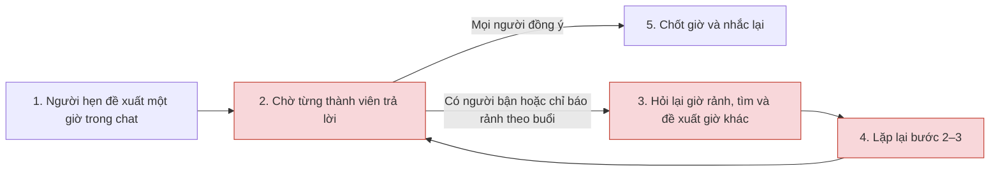
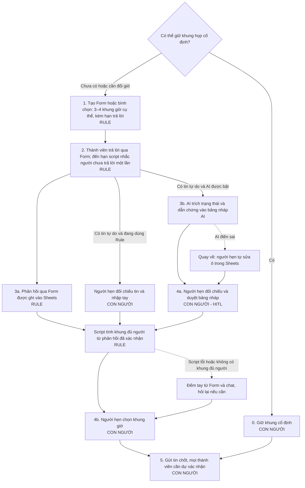

# Báo cáo nhóm — Day 02 Discovery & Problem Framing

> Bản chung của nhóm, viết trên repo do nhóm trưởng fork. Không copy file này sang repo cá nhân.
> Template chi tiết và prompt mẫu: [docs/01-worksheet.md](../../docs/01-worksheet.md). Bài mẫu: [docs/02-deliverable-example.md](../../docs/02-deliverable-example.md).

## 1. Thông tin nhóm

- Tên nhóm: UIT
- Trưởng nhóm: Hà Lê Duy
- Thành viên và phân công: [TEAM.md](../../TEAM.md)
- Candidate problem được chọn (1 câu): **L3 — Chốt giờ họp nhóm.** Thành viên nhóm 3–4 người phải chờ phản hồi và đề xuất lại nhiều vòng để tìm giờ mọi người đều rảnh.
- Quyết định cuối: **Go, phạm vi nhỏ** — pilot 2 tuần với Workflow (Rule làm lõi, AI đọc tin trả lời tự do), xem mục 8.

---

## 2. Hội tụ nhóm (CP3)

### 2.1. Pitch

Danh sách chuẩn bị pitch lấy từ CP2 của [Hà Lê Duy](../individual/2A202603851_HaLeDuy.md#3-top-3-problem-cards--quy-trình-nháp-cp2), [Võ Hồng Lương](../individual/2A202603839_VoHongLuong.md#3-top-3-problem-cards--quy-trình-nháp-cp2), [Nguyễn Đức Nhật](../individual/2A202603812_NguyenDucNhat.md#3-top-3-problem-cards--quy-trình-nháp-cp2) và [Nguyễn Thiên Bảo](../individual/2A202603861_NguyenThienBao.md#3-top-3-problem-cards--quy-trình-nháp-cp2). Số trong mã tương ứng với số Problem Card. Các mốc thời gian đến từ báo cáo cá nhân và cần được xác nhận trước khi dùng làm baseline.

Mỗi người phụ trách phản biện một card của mỗi thành viên còn lại. Câu hỏi chuẩn bị lấy từ CP2 hoặc [worksheet CP3](../../docs/01-worksheet.md#bước-1--pitch-12). Trong buổi pitch, người nghe tự đặt câu hỏi theo nội dung trình bày, rồi ghi câu đã hỏi, người hỏi và điểm cần kiểm chứng.

| Mã | Người pitch | Candidate (Job Story ngắn) | Actor | Bottleneck theo CP2 | Người phụ trách phản biện | Câu hỏi chuẩn bị |
|---|---|---|---|---|---|---|
| D1 | Duy | Khi tổng hợp phản hồi, tôi muốn nhận ra các ý cùng nói về một vấn đề để đánh giá mức độ lặp lại. | PM tổng hợp phản hồi | So ngữ cảnh và gom nhóm, giả định 12 phút cho 15 phản hồi. | Lương | Khi hai phản hồi dùng từ giống nhau nhưng xuất phát từ hai trở ngại khác nhau, nhóm sẽ dùng bằng chứng nào để quyết định gộp hay tách? |
| D2 | Duy | Khi kết thúc họp về phản hồi, tôi muốn biết việc đã chốt và người phụ trách để theo dõi việc thực hiện. | Người điều phối cuộc họp | Phân biệt đề xuất với việc đã chốt và tìm phần phân công, giả định 7 phút. | Nhật | Nếu dùng bảng ghi việc ngay trong cuộc họp, còn bước nào phải làm lại? |
| D3 | Duy | Khi đưa nhận định vào báo cáo, tôi muốn truy lại phản hồi gốc để kiểm tra căn cứ. | PM viết bản tổng hợp | Tìm lại phản hồi gốc từ câu diễn giải, giả định 10 phút. | Bảo | Nếu lưu nguồn ngay từ đầu, còn nhu cầu tìm kiếm nâng cao không? |
| L1 | Lương | Khi báo cáo tuần cho mentor, tôi muốn gom việc đã xong, vướng mắc và kế hoạch để gửi đúng hạn. | Thực tập sinh | Đọc lại commit và task, khoảng 25 phút theo tự thuật. | Bảo | Lần gần nhất chuyện này xảy ra là khi nào? Mất bao lâu? |
| L2 | Lương | Khi nhận đề lab nhiều file, tôi muốn biết đầu ra, hạn nộp và tiêu chí chấm để tránh bỏ sót. | Sinh viên làm lab theo nhóm | Đọc tìm yêu cầu rải rác, khoảng 7 phút trong 10–15 phút/lần theo tự thuật. | Duy | Nếu giảng viên chỉ cần đặt một trang tóm tắt “nộp gì, hạn nào, chấm thế nào” ở đầu mỗi lab, bài toán này còn đáng giải bằng AI không? |
| L3 | Lương | Khi cần họp nhóm, tôi muốn biết giờ mọi người cùng rảnh để giảm nhắn qua lại. | Thành viên nhóm 3–4 người | Chờ trả lời và đề xuất giờ khác, khoảng 6–10 vòng và 30 phút chờ theo tự thuật. | Nhật | Bottleneck thật là bước này, hay là bước trước nó? |
| N1 | Nhật | Khi quyết toán trạm sạc, tôi muốn đối chiếu phiên sạc, điện năng và thanh toán để giải trình chênh lệch trước khi chốt công nợ. | Kế toán và vận hành trạm sạc | Khớp dữ liệu và truy nguyên nhân sai lệch, CP2 nêu 120–160 giờ công/tháng. | Bảo | Đối chiếu theo mã phiên sạc xử lý được bao nhiêu phần trăm khối lượng công việc, và còn lại những ca ngoại lệ nào? |
| N2 | Nhật | Khi chuẩn bị phát hành, tôi muốn tổng hợp thay đổi để QA và PM biết phạm vi cần kiểm thử. | Tech Lead hoặc người phụ trách phát hành | Tra ticket và viết lại thay đổi cho QA/PM, CP2 nêu 35–45 phút. | Lương | Bottleneck thật là bước này, hay là bước trước nó? |
| N3 | Nhật | Khi khách chuyển khoản lúc cao điểm, tôi muốn ghép khoản tiền nhận được với đúng đơn để xác nhận thanh toán. | Chủ shop hoặc nhân viên chốt đơn | Kiểm tra tiền vào và dò đơn khi nội dung chuyển khoản sai, CP2 nêu 2–3 phút/đơn. | Duy | Ai ngoài bạn gặp vấn đề này? Bạn có bằng chứng không? |
| B1 | Bảo | Khi bắt đầu lab mới, tôi muốn nắm đủ đầu ra, tiêu chí và cách nộp để làm đúng từ đầu. | Học viên làm và nộp bài lab | Đối chiếu ba file thành danh sách việc, khoảng 15 phút theo ước lượng cá nhân. | Nhật | Nếu đã có một checklist mẫu dùng lại cho mọi lab, bước đối chiếu còn tốn thời gian không, và có cần AI nữa không? |
| B2 | Bảo | Khi làm bài nhóm, tôi muốn biết ai phụ trách từng phần và đã xong chưa để biết mình nên làm tiếp việc gì. | Thành viên nhóm làm bài trên cùng repo | Chờ người phụ trách cập nhật, khoảng 30 phút theo ước lượng cá nhân. | Lương | Lần gần nhất chuyện này xảy ra là khi nào? Mất bao lâu? |
| B3 | Bảo | Khi lớp có thông báo đột ngột, tôi muốn biết việc cần làm và hạn xử lý đủ sớm để kịp thực hiện. | Học viên nhận thông báo từ nhiều kênh | Phát hiện thông báo muộn, khoảng 10 giờ trong lần gần nhất được kể lại. | Duy | Ai ngoài bạn gặp vấn đề này? Bạn có bằng chứng không? |

**Ghi nhận hỏi – đáp phản biện trong buổi pitch**

Bảng dưới đây tóm tắt tám lượt hỏi – đáp của nhóm trong buổi pitch. Mỗi thành viên đặt hai câu hỏi và trả lời hai câu. Các điểm cần kiểm chứng tập trung vào chỗ nghẽn, bằng chứng và những cách xử lý đơn giản đang có.

| Mã | Người hỏi | Câu hỏi phản biện | Tóm tắt câu trả lời | Điều cần kiểm chứng |
|---|---|---|---|---|
| D1 | Lương | Khi hai phản hồi dùng từ giống nhau nhưng xuất phát từ hai trở ngại khác nhau, nhóm sẽ dùng bằng chứng nào để quyết định gộp hay tách? | **Duy:** Mình sẽ mở lại phản hồi gốc xem người dùng vướng ở đoạn nào. Ví dụ, cùng nói “không biết đơn ở đâu” nhưng một người có thể đang tìm trạng thái đơn, còn người kia đang hỏi vì hàng giao trễ. Chỉ khi đọc ngữ cảnh thấy họ vướng cùng một chuyện thì mình mới gộp. Ca nào chưa rõ thì để PM phụ trách xem lại. | Nhờ PM rà 15 phản hồi, ghi mã nguồn và lý do gộp hoặc tách ở các ca dễ nhầm. |
| D3 | Bảo | Nếu lưu nguồn ngay từ đầu, còn nhu cầu tìm kiếm nâng cao không? | **Duy:** Chắc chưa cần. Mình lưu mã, đoạn trích và link ngay lúc đọc. Nếu cả ba nhận định đều lần về được nguồn và đọc lên thấy đúng ý thì vậy là đủ cho lượt thử. | So thời gian truy nguồn cho các nhận định tương đương khi có và khi thiếu cột mã nguồn. Nhờ một người khác mở link và kiểm tra ngữ cảnh. |
| L2 | Duy | Nếu giảng viên chỉ cần đặt một trang tóm tắt “nộp gì, hạn nào, chấm thế nào” ở đầu mỗi lab, bài toán này còn đáng giải bằng AI không? | **Lương:** Nếu có một trang cập nhật đúng đề, ghi đủ nộp gì, hạn nào và chấm ra sao thì mình dùng trang đó là được. Chỉ khi vẫn phải mở tới mở lui để kiểm mấy yêu cầu riêng, hoặc vẫn sót mục, mình mới tính xem cần thêm hỗ trợ gì. | Bấm giờ bước tìm yêu cầu khi dùng trang tóm tắt và cách đọc hiện tại. So số mục bắt buộc bị thiếu hoặc sai với yêu cầu chính thức. |
| L3 | Nhật | Bottleneck thật là bước này, hay là bước trước nó? | **Lương:** Mất thời gian nhất là đoạn chờ mọi người trả lời rồi lại đổi giờ. Có khi vướng từ lúc đề xuất vì chưa biết ai rảnh. Mình muốn nhìn lại một lần chốt lịch để tách hai đoạn đó ra. | Lấy một lượt chốt lịch và ghi thời điểm đề xuất, các phản hồi, mỗi lần đổi giờ và lúc chốt. |
| N1 | Bảo | Đối chiếu theo mã phiên sạc xử lý được bao nhiêu phần trăm khối lượng công việc, và còn lại những ca ngoại lệ nào? | **Nhật:** Chưa chốt được phần trăm, mình chưa có số đo của cả một kỳ. Ca nào có mã phiên và mã giao dịch khớp thì ghép được trước. Còn phiên mất mã do rớt mạng, có sạc mà chưa thấy tiền, thu trùng hay số điện của trụ lệch với công tơ thì vẫn phải rà riêng. Ghép được nhiều dòng cũng chưa chắc tiết kiệm nhiều giờ, vì mấy ca lệch có thể ngốn phần lớn thời gian. | Dùng mẫu ẩn danh được phép chia sẻ. Đếm tỷ lệ bản ghi ghép được và bấm giờ xử lý phần còn lại để biết khối lượng công việc thực sự giảm bao nhiêu. |
| N3 | Duy | Ai ngoài bạn gặp vấn đề này? Bạn có bằng chứng không? | **Nhật:** Mình nghĩ tới các bạn trực chốt đơn ở shop online, nhất là khi khách chuyển khoản sai mã đơn. Con số 2–3 phút mỗi đơn trong card chưa có log hay người trực xác nhận. | Nhờ nhân viên chốt đơn mô tả lượt gần nhất và quan sát họ ghép một số đơn với giao dịch đã ẩn thông tin khách hàng. |
| B1 | Nhật | Nếu đã có một checklist mẫu dùng lại cho mọi lab, bước đối chiếu còn tốn thời gian không, và có cần AI nữa không? | **Bảo:** Mình thử checklist trước đã. Mẫu giúp nhớ cần tìm gì, còn tên file hay cách nộp thì vẫn phải mở đúng đề lab để điền. Nếu dùng mẫu xong mà vẫn phải lật qua lật lại giữa mấy file thì lúc đó mới xem có cần AI hỗ trợ phần đối chiếu không. | Bấm giờ riêng bước đối chiếu và đếm mục bị thiếu hoặc sai khi dùng checklist mẫu. Mốc 15 phút trong card là ước lượng. |
| B2 | Lương | Lần gần nhất chuyện này xảy ra là khi nào? Mất bao lâu? | **Bảo:** Lúc làm bài nhóm trên repo, muốn biết phần nào còn thiếu thì mình hay phải nhắn 3–4 tin. Chờ đủ người trả lời tầm nửa tiếng, còn tính cả tìm trong chat và mở repo kiểm lại thì khoảng 50 phút. Lần gần nhất là bài nào thì mình chưa ghi. | Đối chiếu một đoạn chat được phép sử dụng với thời điểm cập nhật repo để phân biệt thông tin khó tìm và thông tin chưa được cập nhật. |

### 2.2. Cluster

| Cluster | Các candidate | Pattern chung |
|---|---|---|
| A — Tổng hợp thông tin rời rạc | D1, L1, N2 | Đọc nhiều mẩu thông tin rồi gom thành nội dung người nhận dùng được. Đầu ra lần lượt là nhóm phản hồi, báo cáo tuần và danh sách thay đổi khi phát hành. |
| B — Tìm và đối chiếu căn cứ | D3, L2, B1 | Phải mở lại nguồn để kiểm nội dung trước khi báo cáo hoặc làm bài. L2 và B1 cùng nói về yêu cầu lab nên được gộp khi chấm điểm. D3 vẫn là card riêng về truy dẫn chứng. |
| C — Phối hợp việc và thời điểm | D2, L3, B2, B3 | Cần biết kịp việc gì, ai phụ trách hoặc khi nào thực hiện. L3 tập trung vào chờ phản hồi để chốt giờ. D2, B2 và B3 lần lượt vướng ở xác nhận quyết định, cập nhật tiến độ và phát hiện thông báo. |
| D — Đối soát giao dịch | N1, N3 | Ghép bản ghi từ nhiều nguồn để xác nhận giao dịch và xử lý ca lệch. N1 ở quy mô quyết toán trạm sạc, N3 ở từng đơn hàng. |

### 2.3. Opportunity Solution Tree rút gọn

Cây dưới đây thể hiện bốn cụm ở mục 2.2. Đo outcome bằng thời gian trôi qua trên từng tác vụ cùng loại, từ lúc phát sinh nhu cầu xử lý đến lúc có đủ thông tin để thực hiện đúng.

```text
OUTCOME — Rút ngắn thời gian để có đủ thông tin thực hiện đúng một tác vụ.
├── A. Khó tổng hợp thông tin rời rạc thành nội dung người nhận dùng được.
│   ├── D1. Khó nhận ra phản hồi nào nói về cùng một vấn đề.
│   ├── L1. Khó gom đủ việc đã làm, vướng mắc và kế hoạch cho báo cáo tuần.
│   └── N2. Khó xác định những thay đổi QA và PM cần biết trước khi phát hành.
├── B. Khó tìm đúng căn cứ để kiểm tra nhận định hoặc yêu cầu.
│   ├── D3. Khó truy phản hồi gốc cho nhận định trong báo cáo.
│   └── L2, B1. Khó đối chiếu đầu ra, tiêu chí và cách nộp giữa các file lab.
├── C. Khó biết kịp việc cần làm, người phụ trách hoặc thời điểm.
│   ├── D2. Khó phân biệt việc đã chốt với ý kiến đang bàn sau cuộc họp.
│   ├── L3. Mất nhiều vòng chờ để biết khung giờ chung.
│   ├── B2. Phải chờ phản hồi để biết ai đang làm gì và tiến độ ra sao.
│   └── B3. Phát hiện thông báo muộn nên còn ít thời gian xử lý.
└── D. Khó xác nhận các bản ghi giao dịch tương ứng với nhau.
    ├── N1. Khó khớp phiên sạc với thanh toán và giải thích phần chênh lệch.
    └── N3. Khó tìm đúng đơn khi khoản chuyển thiếu hoặc sai mã đơn.
```

Các phương án để ngoài tầng cơ hội gồm bảng phân công chung, checklist yêu cầu lab, tự động tạo ghi chú phát hành và tự động ghép thanh toán.

### 2.4. Chấm điểm shortlist (1–5)

Shortlist gồm ba bài toán có thể tìm người làm thực tế trong bối cảnh lớp và quan sát một lượt trong phạm vi lab. Điểm là đánh giá từ hồ sơ CP2. Ở cột bằng chứng, 2 điểm là có một tự thuật, 3 điểm là có hai ghi nhận cùng chiều, còn 4–5 điểm cần hiện vật hoặc quan sát trực tiếp.

| Candidate | Actor rõ | Quy trình rõ | Pain có bằng chứng | Impact đo được | Vừa sức lab | So sánh được No AI/Rule/Workflow/Agent | Nhóm hiểu domain | Tổng |
|---|---:|---:|---:|---:|---:|---:|---:|---:|
| **L3 — Chốt giờ họp nhóm** | 5 | 5 | 3 | 5 | 5 | 4 | 5 | **32/35** |
| L2 + B1 — Đối chiếu yêu cầu lab | 5 | 4 | 3 | 4 | 4 | 5 | 5 | **30/35** |
| B2 — Kiểm tra ai đang làm gì trong bài nhóm | 5 | 4 | 2 | 4 | 4 | 3 | 5 | **27/35** |

L3 có một điểm kết thúc dễ xác định khi cả nhóm xác nhận giờ. L2 + B1 có nhiều dạng tài liệu và phương án để so sánh, nhưng cần một danh sách yêu cầu chuẩn để chấm đúng, thiếu hoặc sai. Với B2, có thể đếm tin hỏi lại, song cần xác nhận phần việc thực sự đã xong để phân biệt khó tìm cập nhật với chưa có cập nhật. So sánh các mức can thiệp ở L3 và B2 nên bắt đầu từ cách phối hợp thủ công vì cả hai phụ thuộc vào người tham gia phản hồi.

**Candidate được chọn**

**L3 — Chốt giờ họp nhóm, do Võ Hồng Lương đề xuất.** Khi cần họp, thành viên nhóm 3–4 người muốn biết giờ nào mọi người cùng rảnh để giảm số vòng nhắn qua lại trước khi chốt.

**Vì sao chọn L3**

- Quy trình có đoạn cần kiểm chứng cụ thể. Sau khi có giờ đề xuất, nhóm chờ mọi người trả lời rồi đổi giờ nếu có người bận. Có thể tách thời gian chờ phản hồi khỏi thời gian phải tìm giờ mới.
- Lương và Bảo đều ghi nhận khoảng 6–10 vòng nhắn qua lại và khoảng 30 phút chờ. Hai ghi nhận đến từ cùng nhóm nên đây là mốc tự thuật để đối chiếu. Có thể đo lại số vòng đề xuất và thời gian từ đề xuất đầu tiên đến khi mọi người xác nhận một giờ, đồng thời ghi riêng thời gian chờ.
- Phạm vi vừa một lượt chốt lịch. Nhóm có thể xem lại các mốc giờ trong một đoạn chat được phép dùng và so với cách hỏi giờ rảnh một lượt. Việc chọn L3 mở bước kiểm chứng ở CP4, còn mức can thiệp được quyết định sau khi có kết quả.

**Vì sao hai phương án còn lại trong shortlist không được chọn**

- **L2 + B1.** Hai card cùng gặp khó khi đọc yêu cầu lab, nhưng Lương ước lượng thời gian tìm yêu cầu còn Bảo ước lượng riêng bước đối chiếu ba file. Muốn so được cần chốt cùng một bộ tài liệu và danh sách yêu cầu tham chiếu. L3 có thể kiểm trực tiếp bằng mốc giờ và số vòng trong một lần chốt lịch.
- **B2.** Cùng có thời gian chờ trong chat, nhưng một phần chậm có thể do thành viên chưa cập nhật tiến độ. Cần đối chiếu chat với trạng thái thực tế trên repo để tách hai nguyên nhân. L3 có đầu ra rõ hơn là giờ họp được xác nhận.

**Vì sao các card khác dừng trước shortlist**

| Card | Lý do |
|---|---|
| D1 | Cần PM và mẫu phản hồi được phép dùng để xác nhận các nhóm vấn đề. Số phút ở CP2 là giả định. |
| D2 | Cần biên bản và người tham dự xác nhận việc nào đã chốt. Có thể thử bảng ghi việc trong cuộc họp trước. |
| D3 | Cần nhận định có nguồn gốc mở được cho người rà. Việc lưu mã và link lúc đọc có thể đã đủ cho mẫu nhỏ. |
| L1 | Có trải nghiệm thực tập, nhưng cần báo cáo, commit hoặc task được phép sử dụng để đo lại một lượt. |
| N1 | Cần dữ liệu từ ba nguồn và người có nghiệp vụ xác nhận quy tắc đối soát. Khó thu đủ mẫu trong một buổi lab. |
| N2 | Cần một đợt phát hành có commit và ticket tương ứng. Mốc hiện tại gộp thời gian tra ticket với thời gian biên tập. |
| N3 | Cần tiếp cận người chốt đơn và mẫu giao dịch đã ẩn thông tin khách hàng để kiểm tra các ca ghép sai hoặc thiếu mã. |
| B3 | Mốc 10 giờ đến từ một tình huống tự thuật. Cần thêm ví dụ để phân biệt ảnh hưởng của kênh đăng, cài đặt thông báo và thói quen kiểm tra. |

**Xử lý bất đồng (nếu có)**

Ghi ý kiến khác nếu phát sinh khi nhóm rà điểm. Hai điểm cần đối chiếu trước là số vòng thực tế và phần thời gian chờ phản hồi trong L3.

---

## 3. Kiểm chứng + research giải pháp đã có (CP4)

### 3.1. Assumption Map

Thang điểm 1–5 kế thừa quy ước ở mục 2.4: ở cột **Quan trọng**, 5 là giả định quyết định việc giữ hay đổi hướng bài toán; ở cột **Đã có bằng chứng**, 1 là chưa có dữ liệu tách riêng, 2 là mới có một tự thuật (hoặc hai ghi nhận trong cùng một nhóm), 3 là có từ hai nguồn độc lập cùng chiều, và 4–5 là đã có hiện vật hoặc tài liệu kiểm tra trực tiếp được.

| # | Giả định | Loại (Value / Usability / Feasibility / Viability) | Quan trọng (1–5) | Đã có bằng chứng (1–5) | Kiểm chứng trước? |
|---:|---|---|---:|---:|---|
| 1 | Các nhóm 3–4 người khác khi hẹn họp qua chat cũng phải nhắn qua lại nhiều vòng và chờ lâu tương tự ghi nhận tự thuật của Lương và Bảo (6–10 vòng, khoảng 30 phút). | Value | 5 | 2 | **Có (Ưu tiên 1)** |
| 2 | Thời gian mất chủ yếu nằm ở khâu phải tìm và đề xuất lại giờ mới nhiều vòng khi có người bận, chứ không chỉ do chờ thành viên mở chat trả lời. | Value | 5 | 1 | **Có (Ưu tiên 2)** |
| 3 | Thành viên nhóm sẵn sàng báo các khung giờ rảnh/bận ngay trong một lượt (qua bình chọn hoặc mẫu tin nhắn) thay vì đợi có người đề xuất từng giờ rồi mới phản hồi. | Usability | 4 | 2 | **Có (Ưu tiên 3)** |
| 4 | Nhóm có thể lấy mốc thời gian từ một đoạn chat chốt lịch thực tế (đã che tên) để đếm số vòng đề xuất và tách thời gian chờ phản hồi khỏi thời gian tìm giờ thay thế. | Feasibility | 4 | 4 | Không |
| 5 | Cách gom giờ rảnh một lượt bằng tính năng sẵn có trong ứng dụng chat hoặc công cụ web miễn phí không phát sinh chi phí và không buộc thành viên chia sẻ toàn bộ lịch cá nhân. | Viability | 3 | 4 | Không |

**Giải thích ngắn về điểm số và thứ tự ưu tiên:**

- **Giả định #1 (Quan trọng: 5, Bằng chứng: 2):** Nếu chỉ nhóm hiện tại mất nhiều vòng còn các nhóm khác chốt được ngay trong 1–2 tin nhắn, vấn đề không đủ phổ biến để giải tiếp. Lương và Bảo cùng ghi nhận 6–10 vòng và khoảng 30 phút chờ nhưng thuộc cùng một nhóm, nên tính là một nguồn tự thuật khi xét phạm vi ngoài nhóm (2 điểm).
- **Giả định #2 (Quan trọng: 5, Bằng chứng: 1):** Trả lời câu hỏi phản biện của Nhật ở CP3 (*"Bottleneck thật là bước này, hay là bước trước nó?"*). Nếu thời gian trôi qua chủ yếu vì thành viên chưa đọc tin nhắn (chờ thụ động), việc đổi công cụ tìm giờ hay dùng AI đều không rút ngắn được thời gian chờ. Hiện con số 30 phút đang gộp chung cả hai đoạn nên bằng chứng ở mức 1.
- **Giả định #3 (Quan trọng: 4, Bằng chứng: 2):** Quyết định tính khả dụng của các phương án gom lịch rảnh một lượt (như tạo bình chọn trong chat hoặc nhắn khung giờ bận theo mẫu). Bằng chứng ở mức 2 vì ứng dụng chat đã có sẵn tính năng bình chọn nhưng nhóm vẫn quen nhắn hỏi từng giờ.
- **Giả định #4 (Quan trọng: 4, Bằng chứng: 4):** Cần thiết để thay con số tự thuật bằng baseline đo thật cho CP5, nhưng lịch sử chat nhóm đã lưu sẵn mốc giờ từng tin nhắn nên có thể kiểm trực tiếp ngay.
- **Giả định #5 (Quan trọng: 3, Bằng chứng: 4):** Các tính năng bình chọn trong kênh chat (Zalo, Discord, Messenger) và công cụ web chọn giờ (When2meet, LettuceMeet) đều miễn phí và chỉ yêu cầu đánh dấu khung giờ cho buổi họp đó.

Giả định nhóm kiểm chứng trong buổi này: Kiểm chứng trước **Giả định #1**, **Giả định #2** và **Giả định #3** (ba giả định nằm ở vùng Quan trọng cao 4–5 nhưng Đã có bằng chứng thấp 1–2) thông qua phỏng vấn 2–3 người ngoài nhóm từng chốt giờ họp và đo lại mốc thời gian trên một lượt chốt lịch thật.

### 3.2. Kiểm chứng

Ngày 09/11/2026, nhóm phỏng vấn trực tiếp ba người đã từng chốt giờ họp qua chat, mỗi người thuộc một nhóm học tập khác nhau và đều ngoài nhóm thực hiện báo cáo. A, B và C là mã ẩn danh. Các ghi nhận dưới đây tóm tắt lời kể của người tham gia. Thời gian chốt lịch là ước lượng của họ, chưa có mốc tin nhắn kèm theo để đối chiếu.

#### Ghi nhận phỏng vấn

| Người tham gia | Cách chốt lịch và tình huống được kể | Thời gian và số lượt | Ảnh hưởng |
|---|---|---|---|
| A — Thành viên nhóm 4 người | Nhóm đề xuất họp lúc 20:00 qua Messenger. Hai người trả lời sớm, người cuối phản hồi muộn và báo bận. Nhóm đổi sang 20:30 rồi chốt nhanh. | Khoảng 20–25 phút, 2 lượt đề xuất. Phần lớn thời gian là chờ phản hồi. | Người hẹn phải kiểm tra tin nhắn nhiều lần. Nhóm vẫn kịp nộp bài. |
| B — Thành viên nhóm 3 người | Nhóm đề xuất giờ qua Messenger. Mọi người phản hồi khá nhanh nhưng ban đầu chỉ báo rảnh theo buổi. Sau khi hỏi lại giờ cụ thể, nhóm vẫn chưa tìm được giờ chung trong ngày. | Khoảng 30 phút trao đổi trước khi dời lịch. Chưa xác định số lượt đề xuất. | Buổi họp và việc ghép báo cáo dời sang hôm sau. Nhóm vẫn kịp nộp bài. |
| C — Thành viên nhóm 4 người | Nhóm thường họp cố định tối Chủ nhật và chỉ nhắn xác nhận. Lần được kể, một thành viên về muộn nên cả nhóm lùi giờ họp 15 phút. | Khoảng 5–10 phút để chốt, gồm một lượt xác nhận và một lượt điều chỉnh. | Ảnh hưởng không đáng kể. |

#### Đối chiếu giả định ở mục 3.1

| Giả định | Tín hiệu xác nhận | Tín hiệu phản bác | Kết luận |
|---|---|---|---|
| #1 — Các nhóm khác cũng chờ lâu và phải đề xuất nhiều vòng | A mất khoảng 20–25 phút để chốt. B trao đổi khoảng 30 phút trước khi dời lịch. | A chỉ đổi giờ một lần. B chưa rõ số lượt. C có lịch cố định và chỉ mất khoảng 5–10 phút để chốt điều chỉnh. | Có trường hợp chốt lịch kéo dài. Chưa đủ dữ liệu về số lượt để kết luận các nhóm khác thường phải đổi giờ nhiều lần. |
| #2 — Tìm và đề xuất lại giờ chiếm phần lớn thời gian | B nhận phản hồi khá nhanh nhưng vẫn phải làm rõ giờ rảnh và tìm khung giờ chung. | A mất phần lớn thời gian để chờ người cuối phản hồi và chốt nhanh sau khi đổi giờ. | Có hai nguyên nhân gây chậm. Cần mốc tin nhắn để đo riêng thời gian chờ phản hồi và thời gian tìm giờ thay thế. |
| #3 — Thành viên sẵn sàng báo giờ rảnh trong một lượt | A và B cho rằng gom giờ rảnh một lượt có thể giảm hỏi lại. | C chỉ thấy cách này hữu ích khi cần đổi lịch. | Đây là ý kiến về phương án đề xuất. Mức độ sẵn sàng cần được kiểm tra qua một lượt chốt lịch thực tế dùng phương án này. |

**Điều chỉnh L3 sau phỏng vấn.** Nhóm thu hẹp phạm vi vào các nhóm học tập 3–4 người chưa có lịch họp cố định và cần hẹn qua chat. Việc chốt giờ có thể kéo dài khi phải chờ thành viên phản hồi hoặc khi các khung giờ rảnh chưa được nêu cụ thể và khó tìm giờ chung. Hai nguyên nhân cần được ghi riêng khi đo quy trình.

### 3.3. Research giải pháp đã có

Quy trình chốt lịch hiện tại dùng để đối chiếu: (1) một người đề xuất giờ trong chat → (2) chờ từng người trả lời → (3) có người bận thì tìm và đề xuất giờ khác → (4) lặp lại bước 2–3 → (5) chốt và nhắc lại. Các link được mở và kiểm ngày 09/11/2026; điểm nào trang không ghi thì nhóm không đưa vào.

| Công cụ / case / pattern | Link | Giải bước nào trong quy trình? | Điểm mạnh | Khoảng trống / rủi ro | Bài học cho nhóm |
|---|---|---|---|---|---|
| When2meet (bảng chọn khung giờ) | https://www.when2meet.com/ | Bước 3–4: mỗi người tự tô khung giờ rảnh trên một bảng ngày × giờ, người hẹn nhìn được giờ trùng | Gom giờ rảnh của cả nhóm trong một lượt thay vì hỏi từng giờ; xử lý đúng nguyên nhân của người B (chỉ báo rảnh "theo buổi") | Không giải bước 2: vẫn phải chờ từng người vào điền. Thêm một bước rời khỏi app chat | Nếu nghẽn là "khó tìm giờ chung" thì một lượt gom giờ rảnh là đủ, chưa cần AI |
| Doodle Group Poll (bình chọn giờ đề xuất) | https://doodle.com/en/product/polls/ | Bước 1–4. Người hẹn đưa sẵn vài khung giờ, đặt hạn trả lời và có thể bật nhắc tự động. | Thành viên bình chọn qua một link mà không cần tài khoản Doodle. Người hẹn thấy ai đã phản hồi. | Sau lời nhắc, người hẹn vẫn cần đợi phản hồi. Nếu không có giờ chung, nhóm phải đề xuất thêm khung giờ. | Thử đưa 3–4 khung giờ cùng lúc và nhắc một lần khi đến hạn. Đo riêng số vòng đề xuất và thời gian chờ phản hồi. |
| Google Calendar — "Find a time" | https://support.google.com/calendar/answer/37161 | Bước 1 và 3. Xem giờ rảnh hoặc bận và gợi ý khung giờ từ lịch của khách mời. | Gợi ý dựa trên giờ rảnh và giờ làm việc của khách mời. Người nhận vẫn có thể trả lời lời mời qua email. | Việc xem giờ rảnh phụ thuộc vào quyền truy cập lịch, chẳng hạn lịch được chia sẻ hoặc khách thuộc cùng tổ chức. Lịch thiếu các việc bận thực tế có thể dẫn đến gợi ý sai. | Chỉ dùng lịch làm căn cứ khi nhóm có quyền xem và biết lịch đã được cập nhật. |
| Reclaim.ai — AI Scheduling Links | https://reclaim.ai/features/scheduling-links | Bước 1 và 3: tự tìm giờ trống trên lịch và cập nhật khi lịch thay đổi | Trang ghi "AI agents continuously optimize availability across your calendar"; có gói miễn phí và giảm giá cho sinh viên | Dựa hoàn toàn vào Google Calendar/Outlook. Trang ghi AI có thể dời các sự kiện ưu tiên thấp trên lịch của người hẹn, một hành động nhóm không muốn AI tự làm | Đã có công cụ AI cho bài này, nhưng nó giải bài "có lịch số đầy đủ", khác bối cảnh nhóm học qua chat. Không cần tự xây Agent |
| Pattern: lịch họp cố định hằng tuần | Phỏng vấn C, mục 3.2 | Bỏ qua bước 1–4: chỉ cần một tin xác nhận | Người C chốt trong 5–10 phút, nhanh nhất trong ba người được hỏi; không cần công cụ | Không linh hoạt khi có người bận đột xuất; cần cả nhóm thống nhất từ đầu | Phương án No AI cần so sánh trước: lịch cố định cộng bình chọn khi phải đổi giờ |

**Kết luận.** Với nhóm chưa có lịch cố định, thử trước cách đưa 3–4 khung giờ cụ thể vào một lượt bình chọn, đặt hạn trả lời và nhắc người chưa phản hồi một lần. Các khung giờ cụ thể giúp giảm việc hỏi lại như trường hợp B. Nhắc tự động giúp người hẹn bớt phải canh chat, còn việc người cuối có trả lời sớm hơn như trường hợp A cần được đo trong thử nghiệm. Nhóm sẽ ghi riêng thời gian chờ phản hồi và thời gian hỏi lại hoặc tìm giờ chung. Chỉ thêm AI để đọc tin trả lời tự do nếu đủ điều kiện ở mục 8.2. Nếu sau hai tuần vẫn chưa đạt mục tiêu và thời gian chờ chiếm hơn một nửa, nhóm chuyển sang lịch họp cố định như trường hợp C.

---

## 4. Quy trình trước/sau (CP5)

Phạm vi theo điều chỉnh ở mục 3.2: nhóm học tập 3–4 người chưa có lịch họp cố định, hẹn họp qua chat (Messenger, Zalo, Discord).

Quy ước nguồn số liệu trong mục này:

- **Tự thuật:** Lương và Bảo kể lại trong CP1–CP2.
- **Phỏng vấn:** lời kể của A, B, C ở mục 3.2, là ước lượng của người được hỏi.
- **Ước lượng từng bước:** chia từ tổng 30 phút trong Problem Card #3 của Lương (tự thuật), là mốc cao của khoảng 20–30 phút; A kể khoảng 20–25 phút. Nhóm chưa có mốc tin nhắn để đo riêng từng bước.
- **Mục tiêu đề xuất:** con số nhóm đặt ra để kiểm ở CP5–CP6, chưa phải kết quả đo.

### 4.1. Quy trình hiện tại



| Bước | Actor | Input | Output | Thời gian / tần suất | Ghi chú |
|---:|---|---|---|---|---|
| 1 | Người hẹn (một thành viên nhóm) | Nhu cầu họp, hạn nộp bài | Tin nhắn đề xuất một giờ cụ thể | Khoảng 2 phút (ước lượng). Phát sinh mỗi lần nhóm cần họp ngoài lịch | Người hẹn thường chưa biết ai rảnh khi đề xuất |
| 2 | Các thành viên còn lại | Tin nhắn đề xuất | Phản hồi đồng ý hoặc báo bận | Khoảng 10 phút mỗi vòng (ước lượng). Phỏng vấn A: phần lớn của 20–25 phút là chờ người cuối trả lời | **Bottleneck, nguyên nhân 1:** chờ phản hồi. Người hẹn phải mở chat kiểm tra nhiều lần |
| 3 | Người hẹn và thành viên báo bận | Phản hồi bận; giờ rảnh nêu chung chung "theo buổi" | Một giờ đề xuất mới | Khoảng 8 phút (ước lượng). Phỏng vấn B: khoảng 30 phút trao đổi mà chưa tìm được giờ chung trong ngày | **Bottleneck, nguyên nhân 2:** giờ rảnh không cụ thể nên phải hỏi lại |
| 4 | Cả nhóm | Giờ đề xuất mới | Vòng phản hồi tiếp theo | Khoảng 8 phút cho các vòng lặp thêm (ước lượng). Phỏng vấn A: 2 lượt đề xuất. Phỏng vấn C: 1 lượt xác nhận và 1 lượt điều chỉnh. Tự thuật Lương, Bảo: 6–10 vòng | Số vòng khác nhau nhiều giữa các nhóm; mốc 6–10 vòng chưa được nguồn ngoài nhóm xác nhận |
| 5 | Người hẹn | Giờ được tất cả đồng ý | Tin nhắn chốt giờ và nhắc lại | Khoảng 2 phút (ước lượng) | Nếu không có giờ chung, buổi họp bị dời sang hôm sau (phỏng vấn B) |

**Mốc tham chiếu:** A ước tính chốt sau 20–25 phút, còn Lương và Bảo tự thuật khoảng 30 phút. B trao đổi khoảng 30 phút rồi dời họp, nên mốc này được ghi riêng. C ước tính 5–10 phút để xác nhận và điều chỉnh lịch đã có.

**Bottleneck chính:** vòng lặp bước 2–4, gồm chờ thành viên phản hồi, đề xuất lại khi có người bận và lặp lại các vòng đó. Phỏng vấn cho thấy hai nguyên nhân khác nhau: A chủ yếu chờ người cuối trả lời, B chủ yếu do giờ rảnh không được nêu cụ thể. Theo ước lượng, bước 2–4 chiếm khoảng 26/30 phút.

**Cách đo lại baseline (giả định #4):** đối chiếu ba lượt hẹn từ lịch sử chat đã che tên theo mục 5. Ghi thời điểm đề xuất, phản hồi, đổi giờ và chốt để tách thời gian chờ khỏi thời gian hỏi lại hoặc tìm giờ thay thế.

### 4.2. Quy trình tương lai

Quy trình theo mức **Workflow** đã chốt ở mục 6.2: Rule làm lõi (Google Form, Sheets, Apps Script), AI chỉ làm một việc là đọc tin trả lời tự do trong chat. Nhóm đã có lịch họp cố định (pattern của C) thì không cần các bước này.



[Tệp Mermaid của quy trình tương lai](../assets/cp5-workflow-future.mmd)

| Bước | Ai xử lý | Việc làm | Giải nguyên nhân nào |
|---:|---|---|---|
| 0 | Con người | Nếu giữ được khung họp cố định như C, chuyển thẳng sang bước 5 để xác nhận. | Bỏ qua vòng tìm giờ mới. |
| 1 | Rule | Người hẹn tạo Form hoặc bình chọn theo mẫu cố định: 3–4 khung giờ cụ thể và hạn trả lời | Nguyên nhân 2: buộc báo giờ cụ thể thay vì "theo buổi" |
| 2 | Rule | Thành viên chọn mọi khung mình rảnh trong một lượt. Đến hạn, nhắc người chưa phản hồi một lần theo danh sách đã đối chiếu cả Form và chat. Nếu chưa đối chiếu được hai nguồn tự động, người hẹn xác nhận danh sách trước khi nhắc. | Nguyên nhân 1. Giảm việc canh chat, còn thời gian chờ thực tế được đo trong pilot. |
| 3a | Rule | Phản hồi qua Form được ghi thẳng vào Sheets | Không cần đếm tay |
| 3b | AI | Người hẹn dán tin trả lời tự do đã ẩn danh. AI trích trạng thái từng khung (rảnh, bận, rảnh một phần, không rõ) kèm dẫn chứng vào bảng nháp. | Nguyên nhân 2. Giảm nhập tay khi tin đủ rõ. Người hẹn vẫn hỏi lại khi cần. |
| 4a | Con người (HITL) | Người hẹn đối chiếu mọi ô AI điền với nguyên văn rồi duyệt hoặc sửa. Khi Form và chat mâu thuẫn, người hẹn xác nhận phản hồi còn hiệu lực trước khi duyệt. | Ngăn dữ liệu chưa duyệt lọt vào phép tính giờ chung. |
| — | Rule | Script tính khung đủ người từ Form và các ô chat đã duyệt. Mỗi người chỉ có một trạng thái có hiệu lực cho từng khung. Chỉ trạng thái rảnh trọn khung được tính. | Tính giờ chung theo dữ liệu đã đối chiếu. |
| 4b | Con người | Người hẹn chọn khung hoặc quyết định hỏi lại, họp với đa số hay dời lịch nếu thiếu người. | Giữ quyết định chốt giờ ở người hẹn. |
| 5 | Con người | Người hẹn gửi tin chốt, từng thành viên xác nhận | Tránh hiểu nhầm giờ họp |

**Boundary**

- AI chỉ đọc các tin trả lời giờ rảnh mà người hẹn dán vào, tên đã thay bằng mã thành viên. AI không đọc lịch cá nhân hay toàn bộ lịch sử chat.
- AI không gửi tin, không chốt giờ, không gửi lời mời và không dời lịch (rủi ro đã ghi ở công cụ Reclaim, mục 3.3).
- AI không suy ra "rảnh" từ việc im lặng. Người chưa trả lời luôn là "chưa có thông tin". Câu mơ hồ được ghi "không rõ", "rảnh một phần" không được tính là đủ.

**Khi nào cần con người kiểm tra (HITL)**

- Bước 4a. Người hẹn đối chiếu mọi ô AI điền với nguyên văn trước khi đưa vào phép tính. Bước 4b là lúc chọn khung từ kết quả đã duyệt.
- Khi không có khung nào đủ tất cả thành viên, người hẹn quyết định họp với đa số hay dời lịch.

**Phương án quay về**

- AI điền sai: người hẹn tự sửa ô trong Sheets và ghi vào cột "sửa tay" (dùng làm phản hồi cải thiện ở mục 6.3).
- Script lỗi: người hẹn đếm tay từ Form và đối chiếu tin chat cần thiết.
- Không có khung đủ người: người hẹn hỏi lại thủ công trong chat như quy trình hiện tại, hoặc thống nhất họp với đa số hay dời lịch.
- Thành viên không dùng Form: người hẹn nhập tay nếu đang thử Rule hoặc đã dừng AI. Khi AI được bật, tin đó có thể qua bước 3b rồi được duyệt.

### 4.3. Before / after

| Chỉ số | Trước | Sau (kỳ vọng) | Ghi chú |
|---|---:|---:|---|
| Số bước | 5, bước 2–4 lặp nhiều vòng | 5 bước, không lặp nếu có khung đủ người; 2 bước nếu có khung cố định | Vòng lặp đề xuất lại được thay bằng một lượt gom giờ rảnh qua Form |
| Tổng thời gian | Mốc tham chiếu 20–30 phút từ A và tự thuật của Lương, Bảo. B trao đổi khoảng 30 phút rồi dời lịch. | Dưới 10 phút ở ít nhất 2/3 lượt thử, có đủ xác nhận | Đây là mục tiêu thử nghiệm. Baseline sẽ được đo lại theo mục 5. |
| Số bước thủ công của người hẹn | 5/5 | 3 bước chính (1, 4, 5), thêm thao tác ở bước 3 khi có tin tự do | Bước 4 gồm duyệt dữ liệu và chọn giờ. Việc đối chiếu người cần nhắc ở bước 2 có thể cần làm tay nếu hai nguồn chưa nối được. |
| Bottleneck chính | Vòng lặp chờ phản hồi và đề xuất lại (bước 2–4) | Dự kiến vẫn phải chờ phản hồi ở bước 2 | Hạn trả lời và nhắc tự động giảm việc canh chat. Đo riêng mức thay đổi của thời gian chờ và thời gian hỏi lại. |
| Rủi ro mới phát sinh | — | Thành viên không mở Form mà vẫn nhắn trong chat; AI đọc sai giờ hoặc bỏ điều kiện "trừ…"; script lỗi; người hẹn phải dán tin chat vào AI | Xử lý bằng bước 4 (HITL), các phương án quay về, quy tắc "chưa có thông tin" và thay tên bằng mã thành viên |

Thời gian từng bước ở mục 4.1 là ước lượng. Nhóm cập nhật baseline theo cách đo ở mục 5.

---

## 5. Problem Statement v0 (CP5)

Khi cần tìm giờ họp mới, người hẹn trong nhóm học tập 3–4 người chưa có lịch cố định phải chờ phản hồi và có thể phải hỏi lại giờ rảnh nhiều lần trước khi cả nhóm thống nhất được một khung giờ qua chat.

| Trường | Nội dung |
|---|---|
| **Actor** | Người hẹn là một thành viên của nhóm học tập 3–4 người chưa có lịch họp cố định. Người hẹn đề xuất giờ và theo dõi phản hồi. Các thành viên còn lại báo khả năng tham gia và xác nhận giờ cuối cùng. |
| **Quy trình** | Khi cần phân công bài hoặc ghép báo cáo, người hẹn đề xuất một giờ cụ thể trong chat. Các thành viên phản hồi đồng ý hoặc báo bận. Nếu có người bận hoặc chỉ báo rảnh theo buổi, người hẹn hỏi lại, tìm giờ khác và lặp lại việc lấy phản hồi. Khi mọi người đồng ý, người hẹn thông báo giờ họp. Xem các bước 1–5 ở mục 4.1. |
| **Bottleneck** | Vòng lặp ở bước 2–4 có hai nguyên nhân. A mất phần lớn thời gian để chờ người cuối phản hồi và chốt nhanh sau khi đổi giờ. B nhận phản hồi khá nhanh nhưng vẫn phải hỏi giờ cụ thể và tìm khung giờ chung. Cần ghi riêng hai phần này để đánh giá cách gom giờ rảnh ở mục 4.2 có rút ngắn đoạn tìm và đề xuất lại giờ hay không. |
| **Impact** | A ước tính mất 20–25 phút qua hai lượt đề xuất. Người hẹn phải kiểm tra tin nhắn nhiều lần. B ước tính đã trao đổi khoảng 30 phút trước khi dời cuộc họp và việc ghép báo cáo sang hôm sau. B chưa chốt được giờ trong khoảng 30 phút đó. Cả hai nhóm vẫn kịp nộp bài. |
| **Success Metric** | **Baseline tạm thời:** A chốt sau khoảng 20–25 phút, còn Lương và Bảo tự thuật nhóm mình mất khoảng 30 phút. Đây là các mốc tham chiếu, chưa phải baseline đo từ chat. **Mục tiêu thử nghiệm:** ít nhất 2 trong 3 lượt áp dụng quy trình mới chốt trong **dưới 10 phút** và đủ xác nhận của mọi thành viên cần dự. Ghi riêng các lượt họp với đa số hoặc dời lịch. Cách đo bên dưới áp dụng chung cho quy trình trước và sau. |
| **Boundary và kiểm tra của con người (HITL)** | Nếu dùng AI ở bước 3 của mục 4.2, AI chỉ lập bảng giờ trùng từ các phản hồi giờ rảnh do người hẹn cung cấp. AI không đọc lịch cá nhân hoặc toàn bộ lịch sử chat, không suy đoán giờ rảnh của người chưa phản hồi và không tự chốt, gửi lời mời hay dời lịch. Người hẹn đối chiếu bảng với phản hồi gốc trước khi công bố. Khi bảng sai, thiếu người hoặc không có giờ chung, người hẹn kiểm tra thủ công, hỏi lại hoặc thống nhất với nhóm về việc họp với đa số hay dời lịch. |

### Cách đo trước và sau

1. **Chọn lượt đo.** Lấy ba lần hẹn họp theo cách hiện tại từ lịch sử chat đã ẩn thông tin cá nhân và theo dõi ba lượt áp dụng quy trình mới ở mục 4.2. Chọn các lượt có quy mô nhóm và mức độ gấp tương tự, đều cần tìm giờ mới. Lượt chỉ xác nhận lại lịch cố định như C được ghi riêng.
2. **Ghi mốc giờ và số lượt.** Bắt đầu từ đề xuất đầu tiên. Kết thúc khi đã có tin chốt giờ cụ thể và xác nhận của mọi thành viên cần dự, hoặc ghi thời điểm quyết định họp với đa số hay dời lịch. Giữ nguyên mốc bắt đầu khi đổi giờ. Ghi các khoảng đang đợi phản hồi và các khoảng người hẹn đang hỏi lại hoặc tìm giờ mới, dùng mốc tin nhắn để đối chiếu. Nếu hai việc diễn ra đồng thời thì ghi là khoảng chồng lấn và chỉ tính một lần khi cộng tổng thời gian. Mỗi lần gửi khung hoặc bộ khung mới tính là một lượt đề xuất. Tin nhắc được đếm riêng.
3. **Ghi kết quả của mọi lượt thử.** Phân biệt chốt đủ người, họp với đa số và dời lịch hoặc chưa chốt. Chỉ lượt chốt đủ người trong dưới 10 phút được tính đạt mục tiêu. Báo số lượt đạt trên cả ba lượt thử, đồng thời so sánh thời gian và số lượt đề xuất của các trường hợp chốt đủ người trước và sau.

### Phản biện và cách xử lý trong v0

- **Baseline có thể bị tính sai.** Mốc 30 phút của B dừng ở quyết định dời họp. V0 ghi nhận đây là thời gian trao đổi trước khi dời và dùng lịch sử chat để đo lại các lượt chốt thành công.
- **Mốc dưới 10 phút còn cần thử.** C đạt 5–10 phút khi đã có lịch cố định, còn nhóm trong phạm vi L3 phải tìm giờ mới. V0 giữ mốc ở mục 4.3 làm mục tiêu thử nghiệm và ghi riêng số lượt đạt.
- **Chốt nhanh có thể bỏ sót người cần dự.** V0 yêu cầu đủ xác nhận để tính một lượt đạt. Khi phải họp với đa số hoặc dời lịch, nhóm ghi riêng kết quả để phản ánh đúng tình huống.

---

## 6. Mức can thiệp AI (CP6)

### 6.1. Ma trận độ mơ hồ × độ phức tạp

**Ma trận:** độ phức tạp **thấp** (3–4 người, một cuộc họp, các bước gửi khung → thu phản hồi → tính khung trùng → nhắc → chốt đều cố định). Độ mơ hồ **thấp** ở phần tính khung trùng (đúng/sai rõ), nhưng **cao** ở phần đọc phản hồi: thành viên hay trả lời tự do kiểu "tối mai rảnh sau 8h, trừ 9–10h" thay vì chọn đúng khung (phỏng vấn B: "ban đầu chỉ báo rảnh theo buổi"). → **Workflow có AI ở một bước**, phần còn lại là Rule.

Chờ người cuối trả lời (phỏng vấn A) không phải việc AI làm thay được. Phần này xử lý bằng hạn trả lời và nhắc tự động (Rule).

### 6.2. So sánh 4 mức

| Mức | Phương án cho bài của nhóm | Đủ khi nào | Rủi ro | Chọn? |
|---|---|---|---|---|
| **No AI** (sửa quy trình) | Mẫu tin nhắn 3–4 khung + hạn trả lời; người hẹn tự đếm, tự nhắc | Mọi người trả lời đúng khung ngay lần đầu | Người hẹn vẫn phải mở chat canh phản hồi (A); tin tự do vẫn phải hỏi lại (B) | Phương án quay về |
| **Rule** | Google Form/bình chọn → Sheets + Apps Script tính khung đủ người. Nhắc một lần dựa trên danh sách đã đối chiếu. | Tin chủ yếu đi qua Form hoặc người hẹn có thể nhập tay số ít tin ngoài Form. | Có thể bỏ sót người đã trả lời qua chat nếu chưa đối chiếu hai nguồn. | **Tuần 1 và phương án quay về** |
| **Workflow** | Rule và AI đọc tin trả lời tự do. Người hẹn duyệt bảng nháp trước khi tính giờ chung. | Tỷ lệ tin tự do và bộ eval đạt ngưỡng ở mục 8.2. | AI hiểu sai giờ, bỏ ngoại lệ hoặc suy diễn từ im lặng. | **Chọn có điều kiện** |
| **Agent** | AI tự đọc chat nhóm, tự hỏi lại từng người, tự chốt, tự gửi lời mời, tự dời lịch | Nhiều nhóm, nhiều cuộc họp đan xen, bước tiếp theo không đoán trước được | Vượt quyền chốt và dời lịch (đúng rủi ro của Reclaim.ai, mục 3.3); phải đọc toàn bộ chat và lịch cá nhân | Không chọn |

**Mức chọn:** Workflow — Rule làm lõi, AI chỉ ở một bước: đọc phản hồi tự do.

**Vì sao thử Workflow theo hai giai đoạn.** A mất phần lớn thời gian chờ người cuối trả lời. Hạn trả lời và nhắc tự động giúp giảm việc canh chat, còn hiệu quả đối với thời gian chờ cần đo. B phải hỏi lại vì phản hồi ban đầu chỉ nêu theo buổi. Form có khung cụ thể có thể xử lý phần này nếu thành viên dùng Form. Phỏng vấn chưa đo được tần suất trả lời qua chat khi có Form, nên tuần đầu dùng Rule và nhập tay các tin ngoài Form. Chỉ thêm bước AI nếu tỷ lệ tin tự do và bộ eval đạt điều kiện mục 8.2. Nếu nhóm đã có lịch cố định như C, chỉ cần xác nhận hoặc xử lý khi phải đổi giờ.

**Kiến trúc pilot** (khớp quy trình tương lai ở mục 4.2):

```text
[1 Người hẹn tạo Form/bình chọn: 3–4 khung + hạn trả lời]      ← RULE (mẫu cố định)
→ [2 Thành viên trả lời qua Form; tới hạn script nhắc 1 lần]    ← RULE (Apps Script)
→ [3a Phản hồi qua Form: script ghi vào Sheets]                 ← RULE
  [3b Tin tự do đã ẩn danh → AI trích trạng thái + dẫn chứng
      vào bảng nháp → 4a người hẹn duyệt hoặc sửa]              ← AI + HITL
      [Nếu chỉ dùng Rule, người hẹn đối chiếu và nhập tay]      ← CON NGƯỜI
→ [Script tính khung đủ người từ Form và ô đã duyệt]            ← RULE
→ [4b Người hẹn chọn khung]                                     ← CON NGƯỜI
→ [5 Gửi tin chốt, thành viên xác nhận]                         ← CON NGƯỜI

BOUNDARY: AI không gửi tin, không chốt, không dời lịch; không đọc lịch cá nhân
hay toàn bộ chat; người chưa trả lời luôn là "chưa có thông tin".
PHƯƠNG ÁN QUAY VỀ: AI sai → người hẹn sửa ô nháp; script lỗi → đếm tay từ Form và đối chiếu chat.
```

### 6.3. AI Canvas rút gọn

| Thành phần | Nội dung |
|---|---|
| **Prediction** — AI dự đoán / tạo ra gì? | Trạng thái của người gửi tin ở từng khung: rảnh / bận / rảnh một phần / không rõ, kèm đoạn trích nguyên văn |
| **Judgment** — con người cân nhắc, quyết định gì? | Người hẹn kiểm ô AI điền với nguyên văn; quyết định họp đủ người, họp với đa số hay dời lịch |
| **Action** — hành động cuối cùng là gì, ai làm? | Người hẹn gửi tin chốt; thành viên xác nhận. Script chỉ tính và nhắc, AI không gửi gì |
| **Outcome** — đo kết quả bằng gì? | Thời gian từ đề xuất đầu tiên đến đủ xác nhận; số lần hỏi lại; số ô AI điền bị sửa |
| **Input** — AI cần dữ liệu đầu vào gì mỗi lần chạy? Có sẵn không? | Mã thành viên cần dự, 3–4 khung có ngày, giờ và múi giờ, các tin liên quan đã ẩn danh kèm thứ tự hoặc thời điểm gửi. Người hẹn cung cấp dữ liệu cho đúng lượt họp. |
| **Feedback** — lấy phản hồi ở đâu để cải thiện? | Cột "sửa tay" trong Sheets: ô nào người hẹn sửa, nguyên văn và nhãn đúng. Dùng để bổ sung bộ eval và chỉnh prompt |

### 6.4. Hai câu hỏi của Google PAIR

- **Augment hay automate?** Augment. A và B thấy việc gom giờ rảnh một lượt có thể giảm hỏi lại. Nhóm giữ quyền chốt ở người hẹn vì người này biết có thể họp với đa số hay cần dời lịch để đủ người.
- **Sai kiểu nào tệ hơn?** Báo nhầm “rảnh” có thể khiến nhóm chốt thiếu người. Ghi “không rõ” khi thiếu thông tin giúp người hẹn biết cần hỏi lại. Vì vậy “rảnh một phần” và “không rõ” đều chưa đủ để tính một người rảnh trọn khung.

---

## 7. Problem Statement v1 + tiêu chí đánh giá (CP6)

| Trường | Nội dung |
|---|---|
| **Actor** | Người hẹn trong nhóm học tập 3–4 người **chưa có lịch họp cố định**, hẹn họp qua chat |
| **Quy trình** | Gửi khung giờ → chờ phản hồi → hỏi lại khi phản hồi không cụ thể hoặc có người bận → lặp lại → chốt |
| **Bottleneck** | Vòng lặp bước 2–4, khoảng 26/30 phút (ước lượng): chờ phản hồi (A) và phản hồi không cụ thể phải hỏi lại (B) |
| **Impact** | A ước tính 20–25 phút để chốt và phải mở chat nhiều lần. B trao đổi khoảng 30 phút rồi dời họp sang hôm sau. |
| **Success Metric** | Mốc tham chiếu 20–30 phút từ A và tự thuật của Lương, Bảo. Đo lại baseline theo mục 5. Pilot đạt khi ít nhất 2/3 lượt chốt đủ người trong dưới 10 phút và có 0 lượt công bố đủ người khi thiếu xác nhận. Bước AI cần ≥ 90% ô khớp nhãn tham chiếu và 0 ô “rảnh” sai. |
| **Boundary** | AI không gửi tin, không chốt, không dời lịch; không đọc lịch cá nhân hay toàn bộ chat; không suy ra "rảnh" từ im lặng. Người hẹn duyệt mọi ô AI điền trước khi chốt |
| **AI intervention point** | Bước 3b ở mục 4.2, chỉ với tin trả lời tự do không đi qua Form. Đầu ra nháp phải được duyệt ở bước 4a trước khi script tính giờ chung. |
| **Mức chọn** | Workflow |
| **Rủi ro & người kiểm tra** | AI hiểu sai giờ hoặc bỏ điều kiện → người hẹn đối chiếu nguyên văn và sửa. Script lỗi → người hẹn đếm tay từ Form và đối chiếu chat. Trước khi đưa tin vào AI, người hẹn chỉ giữ nội dung về giờ rảnh và thay tên bằng mã thành viên. |

| Trường | v0 | v1 | Vì sao đổi |
|---|---|---|---|
| Success Metric | Chỉ đo thời gian chốt và đủ xác nhận | Thêm metric cho bước AI: ≥ 90% ô khớp, 0 ô "rảnh" sai | Có bước AI thì phải đo riêng độ đúng: chốt nhanh mà chốt sai người thì không đạt |
| AI intervention point / mức chọn | Chưa chốt. Bước 3 có thể dùng AI để lập bảng giờ trùng. | Workflow có điều kiện. AI chỉ trích tin tự do ở bước 3b, người hẹn duyệt ở 4a rồi Rule tính giờ chung. | Tách việc đọc tin mơ hồ khỏi phép tính giờ trùng và giữ ô chưa duyệt ngoài phép tính. |
| Rủi ro & người kiểm tra | Chỉ có bảng sai hoặc thiếu người | Thêm lỗi script và việc đưa tin nhắn vào AI (thay tên bằng mã) | Thêm thành phần kỹ thuật thì thêm cách hỏng mới, mỗi cách cần người hoặc cách kiểm |

**Tiêu chí đánh giá đầu ra của AI.** Chấm bảng nháp trước khi người hẹn sửa. Chạy [bộ 10 ca mẫu](../assets/cp6-ai-eval.md) bằng prompt và phiên bản mô hình dự định dùng trong pilot.

| # | Tiêu chí | Đạt khi | Không đạt khi |
|---:|---|---|---|
| 1 | Không bịa | Mọi ô có kết luận đều có dẫn chứng nguyên văn. Bảng hợp nhất giữ “chưa có thông tin” cho người chưa gửi tin. | Thêm khung, người hoặc dẫn chứng ngoài đầu vào, hay điền nhãn AI cho người im lặng. |
| 2 | Đúng nhãn và không báo nhầm “rảnh” | Ít nhất 90% ô khớp nhãn tham chiếu và 0 ô “rảnh” sai. Ô thiếu hoặc trùng tính sai. | Dưới 90% ô đúng hoặc có bất kỳ ô “rảnh” nào không khớp nhãn tham chiếu. |
| 3 | Xử lý câu mơ hồ | "Tối mai rảnh" (không có giờ) → "không rõ" | Tự đoán "tối" là 19h–22h rồi ghi "rảnh" |
| 4 | Giữ điều kiện | “Rảnh từ 20:00, trừ 21:00–22:00” với khung 20:30–21:30 → “rảnh một phần”. | Ghi rảnh cả khung hoặc bỏ điều kiện ngoại lệ. |
| 5 | Dùng cập nhật mới nhất | Dùng tin mới nhất có liên quan đến khung được cập nhật, trích tin cũ và mới khi có mâu thuẫn. | Dùng trạng thái cũ hoặc xóa thông tin ở các khung mà tin mới chưa nhắc tới. |

---


## 8. Quyết định (CP6)

### 8.1. Bốn rủi ro

| Rủi ro | Câu hỏi | Mức độ rủi ro (Thấp = an toàn / TB / Cao = nguy hiểm) | Lý do / bằng chứng |
|---|---|---|---|
| **Value** | Người dùng có thật sự cần và sẽ dùng không? | Trung bình | A và B có lần chốt lịch mất 20–30 phút, B phải dời họp; Lương và Bảo tự thuật tương tự. Nhưng C (lịch cố định) chỉ mất 5–10 phút, và mọi con số đều là ước lượng, chưa đo từ chat |
| **Usability** | Người dùng có dùng được, có hiểu và sửa được đầu ra của AI không? | Trung bình | Người hẹn chỉ cần đọc bảng và sửa ô sai, có nguyên văn bên cạnh để đối chiếu. Rủi ro nằm ở thành viên: chưa biết họ có chịu mở Form hay vẫn trả lời thẳng trong chat (giả định #3, chưa có hành vi thật) |
| **Feasibility** | Có đủ dữ liệu, công cụ, kỹ năng để làm không? | Thấp | Google Form, Sheets, Apps Script và bình chọn trong app chat đều miễn phí, có sẵn. Input của AI chỉ là vài tin trả lời ngắn. Nhóm có nền tảng phần mềm; phần khó nhất là viết prompt và kiểm bằng bộ eval ở mục 7 |
| **Viability** | Có hợp chi phí, pháp lý, quy định tổ chức không? Ai vận hành? | Thấp | Chi phí gọi AI rất nhỏ vì mỗi lượt chỉ vài tin. Tin nhắn đưa vào AI chỉ là tin trả lời giờ rảnh, đã thay tên bằng mã thành viên. Người vận hành là người hẹn của nhóm, không cần tổ chức phê duyệt |

### 8.2. Kết luận

**Quyết định:** **Go, phạm vi nhỏ.**

**Lý do:** không có rủi ro mức Cao. Hai rủi ro Trung bình (Value, Usability) kiểm được ngay trong pilot bằng mốc giờ trong chat và tỷ lệ thành viên dùng Form. Các công cụ đều có sẵn nên pilot không cần xây hệ thống mới.

**Nếu Go — pilot nhỏ nhất (2 tuần, 1 nhóm học tập 3–4 người chưa có lịch cố định):**

- **Trước pilot:** đo lại baseline từ 3 lần chốt lịch gần nhất trong chat (đã che tên), tách thời gian chờ phản hồi và thời gian hỏi lại. Chạy bước AI trên bộ eval 10 tin trả lời mẫu, chấm theo 5 tiêu chí ở mục 7; chỉ dùng với nhóm thật khi đạt cả 5.
- **Tuần 1 — chỉ Rule:** Form 3–4 khung, đặt hạn và nhắc một lần. Người hẹn nhập tay tin ngoài Form. Tính tỷ lệ tin tự do theo số thành viên-lượt có phản hồi giờ rảnh cần đọc từ chat chia cho số thành viên-lượt có phản hồi giờ rảnh qua ít nhất một kênh. Mỗi thành viên chỉ được đếm một lần mỗi lượt.
- **Tuần 2 — thêm bước AI:** chỉ khi tỷ lệ tuần 1 đạt ít nhất 20% và bộ eval đạt cả 5 tiêu chí. Nếu chưa có phản hồi để tính tỷ lệ hoặc chưa đạt eval thì tiếp tục dùng Rule. Người hẹn dán tin đã ẩn danh, duyệt bảng nháp và ghi lại ô phải sửa.
- **Mỗi lượt ghi:** thời gian từ đề xuất đầu tiên đến đủ xác nhận, số lần hỏi lại, số ô AI điền bị sửa, kết quả (chốt đủ người / họp với đa số / dời lịch).

**Nếu Not Yet — cần kiểm chứng gì trước:** không áp dụng.

**Nếu No-Go — nên làm gì thay AI:** không áp dụng. Phương án quay về khi pilot không đạt nằm ở ngưỡng dừng bên dưới.

**Ngưỡng dừng:**

- Nếu sau 3 lượt thử, tỷ lệ tin tự do dưới 20% theo cách đếm ở tuần 1 → bỏ bước AI, giữ Rule và nhập tay khi cần.
- Nếu có 1 ô "rảnh" sai do AI điền lọt qua bước duyệt và dẫn tới chốt giờ thiếu người → dừng bước AI, xem lại prompt và bước duyệt trước khi chạy tiếp.
- Nếu phải sửa trên 30% số ô AI đã điền trong ba lượt có dùng AI → quay về người hẹn tự điền ở bước 3.
- Nếu sau 2 tuần, dưới 2/3 lượt chốt đủ người trong **dưới 10 phút** và phần chờ chiếm hơn một nửa thời gian ghi nhận → chuyển sang lịch họp cố định hằng tuần như C. Nếu chưa có đủ ba lượt thử, ghi kết quả là chưa đủ dữ liệu.

---


## 9. Hạn chế và hướng tiếp theo

**Hạn chế**

- **Baseline chưa phải số đo.** Mốc 20–30 phút và 6–10 vòng đến từ tự thuật của Lương, Bảo và lời kể của A, B. Số phút từng bước ở mục 4.1 là ước lượng chia từ tổng 30 phút. Nhóm chưa lấy được mốc thời gian từ một đoạn chat chốt lịch thật.
- **Mẫu kiểm chứng nhỏ.** Chỉ có 3 người được phỏng vấn, đều là sinh viên trong nhóm học tập. Trong đó C là trường hợp đối chiếu vì nhóm đã có lịch cố định. Chưa có survey để biết tình huống của A và B phổ biến đến đâu.
- **Chưa tách được hai nguyên nhân của bottleneck.** A chủ yếu chờ người cuối trả lời, B chủ yếu do phản hồi không cụ thể. Giả định #2 vẫn chưa có số đo để biết nguyên nhân nào chiếm phần lớn thời gian.
- **Hành vi dùng Form chưa được quan sát.** Giả định #3 mới dựa trên ý kiến của A và B. Chưa biết thành viên có chịu trả lời qua Form hay vẫn nhắn thẳng trong chat, nên rủi ro Usability còn ở mức Trung bình.
- **Bước AI chưa được thử.** Bộ 10 ca mẫu đã có nhãn tham chiếu và tiêu chí chấm. Kết quả cần được ghi sau khi chạy với prompt và mô hình dự định dùng trong pilot.
- **Phạm vi hẹp.** Kết luận chỉ áp dụng cho nhóm 3–4 người chưa có lịch họp cố định. Với nhóm như C, lịch cố định (No AI) đã đủ.

**Hướng tiếp theo**

- **Trước pilot:** đo lại baseline từ 3 lần chốt lịch gần nhất trong chat đã che tên, tách thời gian chờ phản hồi và thời gian hỏi lại. Chạy bộ eval 10 tin và chỉ dùng bước AI khi đạt cả 5 tiêu chí.
- **Pilot 2 tuần** theo mục 8.2, tuần đầu chỉ dùng Rule. Áp dụng các ngưỡng dừng đã ghi: nếu tin tự do dưới 20% thì bỏ bước AI, nếu phần chờ phản hồi vẫn chiếm trên một nửa thời gian thì chuyển sang lịch họp cố định.
- **Mở rộng kiểm chứng:** hỏi thêm các nhóm ngoài lớp, ưu tiên nhóm chưa có lịch cố định, để kiểm giả định #1 với nguồn độc lập.
- **Candidate dự phòng:** L2 + B1 (đối chiếu yêu cầu lab, 30/35 điểm ở mục 2.4) có thể đào sâu ở vòng sau, sau khi nhóm chốt một bộ tài liệu và danh sách yêu cầu chuẩn để đo.

## 10. Tài liệu tham khảo

**Dữ liệu sơ cấp của nhóm**

- Bốn báo cáo cá nhân CP1–CP2 của [Hà Lê Duy](../individual/2A202603851_HaLeDuy.md), [Võ Hồng Lương](../individual/2A202603839_VoHongLuong.md), [Nguyễn Đức Nhật](../individual/2A202603812_NguyenDucNhat.md) và [Nguyễn Thiên Bảo](../individual/2A202603861_NguyenThienBao.md): nguồn của 12 candidate ở mục 2 và các mốc tự thuật.
- Phỏng vấn trực tiếp ba thành viên của ba nhóm học tập khác, ghi theo mã A, B, C (mục 3.2). Không lưu tên thật hay thông tin liên lạc.

**Công cụ và pattern đã research (mục 3.3), link mở và kiểm ngày 09/11/2026**

- When2meet: https://www.when2meet.com/
- Doodle, Group Poll: https://doodle.com/en/product/polls/
- Google Calendar Help, Find a time for a meeting: https://support.google.com/calendar/answer/37161
- Reclaim.ai, AI Scheduling Links: https://reclaim.ai/features/scheduling-links

**Tài liệu của lab**

- Worksheet và prompt mẫu: [docs/01-worksheet.md](../../docs/01-worksheet.md)
- Bài làm mẫu: [docs/02-deliverable-example.md](../../docs/02-deliverable-example.md)
- Danh mục framework và nguồn gốc: [docs/03-international-frameworks.md](../../docs/03-international-frameworks.md)

**Framework đã áp dụng** (link theo danh mục ở docs/03)

- Double Diamond, Design Council (toàn bài): https://www.designcouncil.org.uk/resources/framework-for-innovation/
- Job Story, Intercom và Alan Klement (mục 2.1): https://www.intercom.com/blog/accidentally-invented-job-stories/
- Opportunity Solution Tree, Teresa Torres (mục 2.3): https://www.producttalk.org/opportunity-solution-trees/
- Assumptions Mapping, David Bland và Strategyzer (mục 3.1): https://www.strategyzer.com/library/how-assumptions-mapping-can-focus-your-teams-on-running-experiments-that-matter
- The Mom Test, Rob Fitzpatrick (mục 3.2): https://www.momtestbook.com/
- Lean UX, Business Problem Statement, Jeff Gothelf (mục 5 và 7): https://jeffgothelf.com/blog/business-problem-statement-opportunity-statement/
- Building Effective Agents, Anthropic (mục 6.2): https://www.anthropic.com/research/building-effective-agents
- AI Canvas, Agrawal, Gans và Goldfarb, HBR (mục 6.3): https://hbr.org/2018/04/a-simple-tool-to-start-making-decisions-with-the-help-of-ai
- People + AI Guidebook, Google PAIR (mục 6.4): https://pair.withgoogle.com/chapter/user-needs/
- AI evals, Hamel Husain và Shreya Shankar (tiêu chí đánh giá mục 7): https://www.lennysnewsletter.com/p/advanced-evals-how-to-find-and-fix
- The Four Big Risks, Marty Cagan, SVPG (mục 8.1): https://www.svpg.com/four-big-risks/
